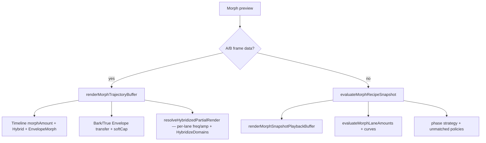

# ATS / ATSH Feature Matrix

Classic **ATS / ATSH** capabilities mapped to the **ATS Plugin** (VST). Status reflects what is wired end-to-end in the product today, not research goals.

## Overview

ATS models sound as **sinusoidal partial tracks** plus **stochastic Bark-band noise**, so tonal and noisy content can be transformed separately. This matrix tracks parity with historical ATSH/Qatsh and modern plugin-only features.

→ Index: [[ATS Plugin - Developer Hub]]

---

## Implementation status (Jun 2026)

**Audited against:** Session, Analysis, Synthesis, Partials, Math tabs; `src/plugin/*`; `src/core/` (`AtsMorphRecipe`, `AtsSpectralEnvelope`, `AtsTransientSmear`, `AtsFrequencyShape`); ATSA via Qatsh. Worktree `.worktrees/spectral-envelope/` audited separately for RDC/GCV (not merged to main `src/`).

### Render paths

| Path | When used |
| ---- | --------- |
| **`renderMorphTrajectoryBuffer`** | Primary audible morph — frame-wise oscillator bank when Source A/B frame data exists |
| **`evaluateMorphRecipeSnapshot`** | Fallback when A/B frames unavailable (preset load) or timeline segment fallback → `renderMorphSnapshotPlaybackBuffer` |

**Main render reads:** timeline **Morph** amount; **Hybrid** / **EnvelopeMorph** breakpoints; correspondence (rank, greedy, assignment matrix + per-chunk `reassignCorrespondenceByLogFrequency`); frequency shaping on A/B; Bark/True Envelope transfer via `applySpectralEnvelopeTransfer` + `resolveHybridizedPartialRender`; residual band morph with envelope transfer + `softCapEnvelopeBoost`; transient **onset offset only** (`maxOnsetAlignmentOffsetSeconds`); per-lane morph amounts (Frequency, Amplitude, ResidualNoise lanes via `evaluateMorphLaneAmount`); interpolation domains (`HybridizeDomains`: Bark vs log freq, dB vs equal-power amplitude); per-chunk timbre motion (`CompiledTimbrePlan` brightness/tilt/noise).

**Still snapshot-only:** phase strategy, transient policy, unmatched policies, performance macro, smoothing, Time lane. See [Priority queue](#priority-queue).

### Legend

| Status | Meaning |
| ------ | ------- |
| **Done** | UI (where applicable) + engine + audible preview or export |
| **Partial** | Subset, offline-only, tests-only, or UI ahead of render wiring |
| **Not started** | No meaningful implementation |

### Summary by area

| Area | Done | Partial | Not started |
| ---- | ---- | ------- | ----------- |
| Analysis model | 7 | 0 | 0 |
| Pitch & frequency | 4 | 1 | 2 |
| Time | 4 | 3 | 1 |
| Amplitude & envelope | 1 | 6 | 1 |
| Noise | 4 | 2 | 0 |
| Spectral editing | 2 | 4 | 0 |
| Hybridization & morphing | 1 | 5 | 1 |
| Psychoacoustic | 3 | 1 | 0 |
| ATSH graphical editing | 4 | 4 | 0 |
| Plugin workflow & UI | 16 | 4 | 0 |
| Modern extensions | 0 | 2 | 7 |

### What works in main morph render

- Timeline **Morph** amount; **Hybrid** / **EnvelopeMorph** breakpoints
- Correspondence: freq rank, greedy, assignment matrix; per-chunk log-freq repair
- Frequency shaping on A/B; end-of-source fade
- Envelope transfer on partials **and** residual bands (+30 dB soft cap)
- Smearnov live preview on trajectory play

### Recent shipping notes

- **Smearnov (Jun 2026):** five flux detectors, editable overlay, live transport preview, Apply bake. RPCA toggle is **disabled** (not implemented).
- **Spectral envelope morph (Jun 2026):** True Envelope + Bark, de-color/apply, formant-aligned blend; timeline Hybrid + EnvelopeMorph; Iso 3D Envelope / Env (RDC) display viz (`rdcDisplay::fitRDC`). Offline **Smooth Spectral Envelope** edit via `reimposeRdcEnvelopeFrame`. Full production RDC estimator stack lives in worktree only — [[Spectral Envelope - PRD Summary]].
- **Morph lane curves (Jun 2026):** per-lane `MorphCurveShape` (linear/ease in/out/in-out) in recipe, preset, and snapshot eval; **not** wired to main render yet.
- **Frequency shaping + Bark residual editor (May 2026):** Synthesis warp + morph render; spectrogram residual edit toolbar.
- **GCV λ baselines (worktree, Jun 2026):** opt-in Stage 1 baseline recorded in `SPECTRAL_ENVELOPE_BASELINES_GCV.md`; fixed-λ New RDC beats Bark on 55% of ATSA reference frames; GCV is **not a promotion candidate** (dense-clean C++ gate still open).

### Largest gaps

Formant-preserving pitch; partial freq drawing; RT oscillator bank in `processBlock`; wire morph lanes/policies/curves to main render; merge worktree RDC into main morph path; arbitrary warp maps; envelope panel beyond timeline; more than two morph sources.

---

## Analysis model

| Feature | Description | Status | Evidence |
| ------- | ----------- | ------ | -------- |
| Partial tracking | Continuous sinusoidal trajectories | **Done** | `trackLen`, `minSegLen`, `minGapLen`; Analysis tab + profiles |
| Frequency estimation | Peak interpolation and trajectory linking | **Done** | `freqDev`, window/hop controls |
| Amplitude tracking | Per-partial amplitude envelopes | **Done** | Partials tab cell edit; spectrogram scale |
| Phase tracking | Phase continuity for resynthesis | **Partial** | Analysis type 2+; Synthesis “Use partial phases”; morph seeds phasors at t=0; phase strategy combo = snapshot only |
| Noise modeling | Residual in critical bands | **Done** | Type 3/4; `band_energy`; residual audition |
| Bark band analysis | Noise in psychoacoustic bands | **Done** | Residual / Iso 3D Residual + Bark edit toolbar |
| SMR analysis | Signal-to-mask ratio weighting | **Done** | SMR thresholds and weights in Analysis |

---

## Pitch & frequency

| Feature | Description | Status | Evidence |
| ------- | ----------- | ------ | -------- |
| Pitch shift | Scale partial frequencies | **Done** | Synthesis `freq`; MIDI note-on in `processBlock` |
| Formant-preserving pitch | Pitch fixed envelope | **Not started** | Envelope morph exists; not pitch+fixed envelope |
| Frequency stretching | Non-linear expansion | **Done** | Frequency shaping Stretch + live warp + preview |
| Frequency compression | Non-linear compression | **Done** | Frequency shaping Compress |
| Harmonic scaling | Harmonic series warp | **Done** | Frequency shaping Harmonic + auto F0 pivot |
| Partial detuning | Per-partial offsets | **Partial** | Partials tab per-cell freq; no spread UI |
| Spectral warping | Arbitrary freq map | **Not started** | Morph log/Bark interp only |

---

## Time

| Feature | Description | Status | Evidence |
| ------- | ----------- | ------ | -------- |
| Time stretch | Temporal rescale, fixed pitch | **Done** | Synthesis `timeStretch` |
| Time compression | Shorten duration | **Done** | Same control (< 1.0) |
| Spectral freeze | Hold partial state | **Not started** | — |
| Temporal interpolation | Morph between states | **Partial** | Morph timeline + lane eval in snapshot; Time lane not in main render |
| Trajectory resampling | Different temporal rate | **Partial** | Via time factor + hop; no dedicated tool |
| Scrubbing | Non-linear traversal | **Partial** | Playhead during preview only |
| Onset detection | Find attacks in model | **Done** | Smearnov D1–D5; overlay + markers |
| Attack smearing | Blur/sharpen/exaggerate attacks | **Done** | Smearnov macro; live preview; Apply bake |

---

## Amplitude & envelope

| Feature | Description | Status | Evidence |
| ------- | ----------- | ------ | -------- |
| Gain scaling | Global levels | **Done** | `partGain`, `resGain`, `outputTrim` |
| Partial gain scaling | Selected traces | **Partial** | Spectrogram vertical drag scale |
| Envelope remapping | Trajectory reshape | **Partial** | MathExpr; Partials tab; residual band draw |
| Spectral tilt | Brightness emphasis | **Partial** | Residual Tilt; not on partial traces |
| Harmonic weighting | Harmonic balance | **Not started** | — |
| Spectral envelope estimation | Fit envelope over partials | **Partial** | `BarkSpectralEnvelope`; display-only `rdcDisplay::fitRDC`; offline `reimposeRdcEnvelopeFrame`; worktree `RegularizedCepstrum` (pre-merge) |
| Spectral envelope transfer | De-color + apply target | **Partial** | `applySpectralEnvelopeTransfer`, `FormantAlignedEnvelopeMorph`, `softCapEnvelopeBoost`; Hybrid timeline; morph render on partials + bands |
| Spectral filtering | Edit via partials | **Partial** | Mute/delete partials and bands |

---

## Noise

| Feature | Description | Status | Evidence |
| ------- | ----------- | ------ | -------- |
| Noise-only resynthesis | Stochastic alone | **Done** | Audition Residual |
| Harmonic-only resynthesis | Partials alone | **Done** | Audition Partials |
| Noise scaling | Band levels | **Done** | `resGain`; drag scale; per-cell dB on `band_energy` |
| Noise redistribution | Move energy between bands | **Partial** | Copy/paste/swap band clipboard |
| Noise morphing | Interpolate noise structures | **Partial** | Residual crossfade + envelope transfer in render; Noise lane = snapshot only |
| Residual manipulation | Direct band edit | **Done** | Lasso, draw, smooth, tilt, clipboard; `mutateResidualBandFrames` |

---

## Spectral editing

| Feature | Description | Status | Evidence |
| ------- | ----------- | ------ | -------- |
| Partial deletion | Remove tracks | **Done** | Delete → `mutePartials` |
| Partial isolation | Solo trajectories | **Partial** | Multi-select + audition; no solo button |
| Partial cloning | Duplicate structure | **Not started** | — |
| Partial group editing | Harmonic groups | **Partial** | Lasso multi-partial ops |
| Spectral pruning | Low-SMR removal | **Partial** | At analysis via SMR thresholds |
| Harmonic extraction | Subset isolation | **Not started** | — |

---

## Hybridization & morphing

| Feature | Description | Status | Evidence |
| ------- | ----------- | ------ | -------- |
| Spectral interpolation | Blend trajectories | **Done** | `renderMorphTrajectoryBuffer` + timeline Morph amount |
| Timbre morphing | A↔B transition | **Partial** | Dual slots, timeline, bounce, lane curves in snapshot; lane UI ahead of main render |
| Formant-aligned envelope morph | Formant-warped blend | **Partial** | `FormantAlignedEnvelopeMorph`; EnvelopeMorph timeline in render |
| Partial replacement | Unmatched partial policies | **Partial** | Policy combos + snapshot; main render uses `resolveHybridizedPartialRender` (in-place crossfade, no glide) |
| Noise transfer | Borrow stochastic model | **Partial** | Residual morph + Hybrid on bands |
| Cross-synthesis | Multi-property merge | **Partial** | Timeline envelope kinds; lanes snapshot-only |
| Multi-sound hybridization | More than two sources | **Not started** | A and B only |

---

## Psychoacoustic

| Feature | Description | Status | Evidence |
| ------- | ----------- | ------ | -------- |
| SMR weighting | Important partials first | **Done** | Analysis + tracking weight |
| Masking-based pruning | Drop inaudible data | **Partial** | Analysis thresholds; no SMR map UI |
| Critical band modeling | Bark noise representation | **Done** | Model + morph Bark/Mel grid + residual editor |
| Perceptual resynthesis | Adaptive partial budget | **Not started** | — |

---

## ATSH graphical editing

| Feature | Description | Status | Evidence |
| ------- | ----------- | ------ | -------- |
| Trajectory editing | Draw/edit paths | **Partial** | Partials: scale/delete; residual: envelope draw |
| Spectral visualization | Trace views | **Done** | `SpectrogramPanel` modes |
| Envelope visualization | Envelope surfaces | **Partial** | Iso 3D Envelope / Env (RDC) display fit; worktree envelope workspace panel (pre-merge) |
| Noise visualization | Stochastic view | **Done** | Residual modes + Hz gutter |
| Bark-band noise editor | Per-band edit | **Done** | Draw, smooth, tilt, clipboard, cell dB |
| Partial selection | Subset tools | **Done** | Click, lasso, band/time selection |
| Interactive resynthesis | Immediate feedback | **Partial** | Background resynth → buffer playback |
| Morphing interface | Morph controls | **Partial** | Timeline + macro in render; per-lane amounts + curves in snapshot only |

---

## Plugin workflow & UI (outside classic ATSH taxonomy)

| Feature | Description | Status | Evidence |
| ------- | ----------- | ------ | -------- |
| Dual morph source slots | Source A / B | **Done** | Load, re-analyze, export .ats, listen |
| WAV + ATS import | External material | **Done** | Analysis + Session import |
| Worker-thread analysis | Off audio thread | **Done** | startAnalysis, transformThread |
| Offline preview transport | Buffer playback | **Done** | playbackBuffers; no RT analysis in processBlock |
| MIDI transpose (preview) | Keyboard offset | **Done** | MIDI → synthesis freq |
| Morph timeline editor | Breakpoints over time | **Done** | Morph / Hybrid / EnvelopeMorph; bounce WAV |
| Morph variation slots | V1–V3 recall | **Done** | Save/recall macro + lanes |
| Full-state presets | .atspreset files | **Done** | Parameters + embedded model |
| Morph snapshot status | Stale/ready UX | **Done** | Session status label |
| Morph band diagnostics | Per-band inspect | **Partial** | MorphBandStrip; policies in snapshot energy |
| Correspondence strategies | A↔B mapping | **Done** | Rank, greedy, assignment matrix in render |
| Bark / Mel morph grid | Band assignment | **Done** | kMorphGridType |
| Classic Both playback | Combined vs sum | **Done** | Synthesis Both playback mode |
| Smearnov detection overlay | Detector curves | **Done** | Spectrogram overlay |
| Spectrogram view modes | Seven layouts | **Done** | Combined through Iso Env (RDC); Current/A/B |
| Per-lane morph controls | Six lanes + curves | **Partial** | UI + recipe + snapshot + main render for Freq/Amp/Noise lanes (`evaluateMorphLaneAmount`, `MorphCurveShape`, `HybridizeDomains`); Time/Phase/Transient lanes snapshot-only |
| Morph amount (macro) | Global blend | **Done** | kMorphAmount; constant morph preview |
| Morph performance macro | Macro feel | **Partial** | APVTS/preset only; no Session control |
| Morph control smoothing | De-click | **Partial** | Session slider; not in render |
| MathExpr offline transforms | Script edits | **Done** | Math tab, worker thread |

---

## Modern extensions

| Feature | Foundation | Status | Evidence |
| ------- | ---------- | ------ | -------- |
| AI timbre morphing | Spectral interpolation | **Not started** | Classical recipe only |
| Neural instrument hybridization | Partial replacement | **Not started** | — |
| Spectral diffusion models | Noise + partial separation | **Not started** | — |
| Constraint-based timbre generation | Trajectory rules | **Partial** | Morph recipe + `morph_recipe_test` |
| Spectral envelope transfer (RDC) | RDC + recipes | **Partial** (worktree) | Main: Bark/True Envelope morph + display RDC; worktree: Phases 0–8 estimator (BIC, IRLS, gap fill, opt-in GCV λ); merge not started — [[Spectral Envelope - PRD Summary]] |
| Generative spectral composition | Trajectory synthesis | **Not started** | — |
| Timbre grammars | Harmonic/noise rules | **Not started** | — |
| Spectral canon generation | Time-shifted structures | **Not started** | — |
| On-chain spectral NFTs | Compact ATS storage | **Not started** | `.ats` / preset export |
| Differentiable spectral synthesis | Trajectory representation | **Not started** | — |

---

## Priority queue

Ordered by musical payoff and dependency. Items with UI already present are finishing work, not greenfield.

| Prio | Milestone | Status today |
| ---- | --------- | ------------ |
| **P0** | Wire morph lanes + policies + curves into `renderMorphTrajectoryBuffer` | **Partial** (Freq/Amp/Noise lanes + interpolation domains wired Jun 2026; Time/Phase/Transient + unmatched policies still snapshot-only) |
| **P0** | Real-time morph preview (no full re-bounce per tweak) | **Partial** |
| **P0** | Morph fixture audio + metric CI | **Partial** (`asset_status: placeholder`; smoke harness only) |
| **P1** | Merge worktree RDC into main morph path + envelope UX | **Partial** (worktree R&D feature-complete; fixed-λ default, GCV opt-in only) |
| **P1** | Partial trajectory draw/edit (freq vs time) | **Partial** |
| **P1** | Spectral freeze + scrub-driven preview | **Not started** / **Partial** |
| **P2** | Noise redistribution (auto / drag between bands) | **Partial** |
| **P2** | Partial solo + harmonic group ops | **Partial** |
| **P2** | Spectral tilt on partial traces | **Partial** |
| **P2** | Arbitrary spectral-warp maps | **Partial** |
| **P2** | Morph macro + smoothing in render | **Partial** |
| **P2** | Multi-source hybrid (>2) | **Not started** |
| **P3** | Partial cloning | **Not started** |
| **P3** | Perceptual resynthesis | **Not started** |
| **P3** | Modern ML extensions | **Not started** |

### Already in good shape

- Dual-source workflow, `.ats` I/O, timeline bounce
- Nine analysis profiles, SPARAMS + frequency shaping on morph
- Correspondence strategies + per-chunk repair + envelope timeline kinds in render
- Envelope transfer on partials and residual bands with soft cap
- Spectrogram (7 modes), Smearnov, Bark residual editor
- Variation slots, `.atspreset`, MathExpr, morph lane curve serialization
- **Main tests:** `morph_recipe_test`, `morph_transport_test`, `morph_transport_correspondence_test`, `frequency_shape_test`, `spectral_envelope_transfer_test`, `ats_transient_smear_*`, `morph_fixture_manifest_check.py`
- **Worktree tests (pre-merge):** `regularized_cepstrum_test`, `spectral_envelope_improvements_test`, `spectral_envelope_fixture_metrics_test`, `benchmark_gcv_reference_profiles.py`

---

## Core insight

ATS is a **structured representation** of sound—not a frame-based effect. Partial trajectories, independent noise, and SMR weighting suit morphing, hybrid instruments, generative systems, and (with licensing clarity) compact interchange via `.ats` and presets.
