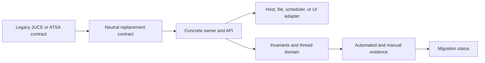

# ATS Resynth — Complete JUCE Removal and Replacement Specification

**Status:** implementation specification

**Migration branch:** `remove-juce`

**Repository:** `/Volumes/Extreme SSD/ATS-PLUGIN`

**Baseline branch at migration start:** `ui-refactor` (the working tree was
already dirty; those changes are preserved on `remove-juce`)

**Scope:** replace the JUCE processor shell, parameter/state layer, editor,
plugin wrappers, build integration, file/preset services, and JUCE utility
types while preserving ATS behavior, host identity, project recall, and the
documented UI contract.

This document is intentionally implementation-ready. It is the normative
replacement plan for ATS Resynth, not a generic “swap the framework” checklist.

## Contents

- [Implementation-agent prompt](JUCE_REMOVAL_IMPLEMENTATION_AGENT_PROMPT.md)
- [Implementation-agent handoff](#0-implementation-agent-handoff--read-this-first)
- [Executive decision](#1-executive-decision)
- [Baseline and scope freeze](#2-baseline-authority-and-scope-freeze)
- [JUCE dependency matrix](#3-juce-dependency-removal-matrix)
- [Host identity and formats](#4-host-identity-and-format-contract)
- [Parameter contract](#5-parameter-contract)
- [Host-neutral architecture and real-time rules](#6-host-neutral-processor-and-real-time-architecture)
- [ATS algorithms and DSP](#7-ats-analysis-synthesis-and-algorithm-preservation)
- [State, presets, files, and undo](#8-state-preset-and-file-compatibility)
- [UI architecture and functional surfaces](#9-ui-architecture-and-functional-surface)
- [Actions and telemetry](#11-ui-neutral-action-and-telemetry-protocol)
- [CMake and dependency layout](#12-cmake-and-dependency-layout)
- [Implementation phases and execution cards](#13-implementation-phases-and-commit-gates)
- [Validation ladder](#14-validation-ladder)
- [Deviation register](#15-deviation-and-risk-register)
- [Definition of done](#17-definition-of-done)
- [UI post-mortem amendment and surface inventory](#20-mandatory-ui-parity-amendment-from-the-cf-synth-post-mortem)
- [Spectrum views and menus](#22-spectrum-views-and-menus-complete-carry-over-contract)
- [All other ATS UI elements](#23-complete-carry-over-contract-for-all-other-ats-elements)
- [Verification mechanisms](#24-verification-mechanisms-and-evidence-artifacts)
- [Architecture and DSP traceability](#27-architecture-and-dsp-contract-traceability)
- [Parity-gap audit](#28-parity-gap-audit-and-corrective-requirements)

The three external migration documents supplied with this task are used as
review evidence:

- [Common issues and reusable playbook](../../COMPRESSED_FEEDBACK/CompressedFeedbackVST/JUCE_REMOVAL_COMMON_ISSUES_AND_REUSABLE_PLAYBOOK.md)
- [CF Synth review and migration specification](../../COMPRESSED_FEEDBACK/CompressedFeedbackVST/JUCE_REMOVAL_REVIEW_AND_MIGRATION_SPEC.md)
- [CF Synth UI interaction post-mortem](../../COMPRESSED_FEEDBACK/CompressedFeedbackVST/CF_SYNTH_UI_INTERACTION_POSTMORTEM.md)

The ATS-specific source material remains authoritative for product behavior:

- [ATS UI implementation spec](ats-mearcstapa-ui-spec.md)
- [Mearcstapa style reference](mearcstapa-ui-style-reference.md)
- [Spectrum view overhaul](spectrum-view-overhaul-spec.md)
- [Smearnov spec](SMEARNOV_SPEC.md)
- [MathExpr spec](MATHEXPR.md)
- [Noisc partial-editing spec](noisc-partial-editing-spec.md)
- [Morph-to-ATS analysis tasks](MORPH_TO_ATS_ANALYSIS_TASKS.md)
- [DSP fidelity PRD](DSP_FIDELITY_PRD.md)
- [Determinism requirements](DETERMINISM.md)
- [Release checklist](RELEASE.md)

## 0. Implementation-agent handoff — read this first

This section is written for an implementation agent with limited context. It
turns the rest of the document into operating rules. The agent must read this
section, §2, §13, §20, §21, §27, and §28 before changing production code.
The copy/paste handoff is also checked in as
[`docs/JUCE_REMOVAL_IMPLEMENTATION_AGENT_PROMPT.md`](JUCE_REMOVAL_IMPLEMENTATION_AGENT_PROMPT.md).

### 0.1 Immediate objective

Remove JUCE from ATS while preserving the current ATS source behavior. Work in
small, reviewable slices. At every slice, leave the repository buildable and
leave a machine-readable traceability record pointing from the old symbol or
behavior to the new owner and test.

Do not attempt a line-by-line rewrite of `AtsAudioProcessor`. Extract one
contract at a time: buffers/MIDI, parameters, state, jobs, playback, host
adapter, editor seam, then UI surfaces. Keep the JUCE implementation available
as the comparison oracle until the relevant replacement tests pass.

### 0.2 Authority order when documents disagree

Use this order of authority:

1. the frozen ATS source commit and its executable behavior;
2. independent ATS tests, state/preset fixtures, and patch fingerprints;
3. ATS-specific design/specification documents, only for behavior absent from
   source or explicitly promoted by a decision;
4. the supplied CF Synth documents, only for migration hazards, validation
   mechanisms, and event-model lessons.

Never copy a control, menu, preset action, timer, data source, or algorithm from
the reference repository merely because it appears there. If a source/design
conflict is found, add a discrepancy ID, mark the surface scope, and stop that
surface until the decision is recorded. The current ATS corrections already
identified in this document include the preset menu, output meter, output
spectrum, keyboard, five-step quick snapshots, and spectrum `setView` cleanup.

### 0.3 Non-negotiable rules

- Do not reset, discard, or overwrite unrelated dirty-worktree changes.
- Do not change plugin IDs, parameter IDs/order, bus layout, state magic, state
  reader compatibility, preset namespace, or Qatsh patch requirements.
- Do not implement `documented_only` surfaces until they are promoted with a
  decision, owner, state/data source, and tests.
- Do not claim parity from compilation, a JUCE grep, a screenshot, or a direct
  widget unit test alone.
- Do not use JUCE, VST3, AU, UI-backend, filesystem, or platform-window types in
  `src/core` or the neutral ATS engine.
- Do not allocate, lock, access files, call UI code, parse strings, dispatch to
  the main thread, or join workers from `audio_rt`.
- Do not infer completion from a timer. Workers return typed success, failure,
  or cancellation with a generation ID.
- Do not create a fake popup, fake mouse event, synthetic meter animation, or
  placeholder spectrum and call it functional evidence.
- Do not silently “improve” source behavior. A cleanup that changes focus,
  selection, gesture cancellation, timing, copy, or layout is a deviation.

### 0.4 Required first actions

Before implementation code is changed, the agent must:

1. confirm `git branch --show-current` is `remove-juce` and record the current
   dirty paths without modifying them;
2. run the architecture and UI manifest validators;
3. freeze `docs/juce-removal-baseline/` from the exact source commit, or record
   a named blocker if the source commit/backend revision cannot yet be pinned;
4. write the UI backend ADR and target event-model proof before porting any
   interactive control;
5. generate the independent 81-parameter manifest and factory/profile counts;
6. create the first traceability update with the symbols/files being moved;
7. build/test the current non-plugin targets before using them as a comparison
   oracle.

If steps 3–5 cannot be completed, the agent may work only on framework-free
primitives and test harnesses. It must not guess the baseline.

### 0.5 Task packet format

Every implementation task must begin with a packet containing:

```text
Task ID:
Trace IDs:
Legacy symbols/files:
Replacement owner/API:
Thread domain:
State/format impact:
Source-current or documented-only scope:
Required tests:
Expected evidence:
Known deviations/blockers:
```

The task is complete only when the packet's tests run, the traceability record
is updated, and the evidence path is recorded. A task that discovers a new
parameter, state field, menu item, timer, visible surface, DSP branch, or JUCE
dependency must stop and add a traceability row before continuing.

### 0.6 Implementation order

Use this order unless an ADR documents why it must change:

```text
baseline → event/backend proof → core primitives → parameter/state
→ ATS engine/DSP extraction → jobs/playback → native host wrappers
→ neutral editor seam → UI surfaces → real dispatch/host validation
→ JUCE removal scan and release packaging
```

Never start with the visual editor. The editor depends on stable parameter,
state, action, telemetry, and playback contracts. The spectrum canvas depends
on a pure trace snapshot builder; it must not read mutable model arrays.

### 0.7 Completion language

Use the traceability status vocabulary exactly: `baseline`, `mapped`,
`implemented`, `verified`, `deviated`, `blocked`, `retired`. `implemented` means
code exists and a focused test runs. `verified` requires the appropriate
cross-layer evidence. Use `blocked` only for a named external decision or
dependency, never as a synonym for unfinished work. Never report “complete” if
any required row is only `mapped` or if a documented-only feature has no
promotion/exclusion decision.

## 1. Executive decision

ATS Resynth will become a layered, host-agnostic C++ plugin with:

```text
ATS core + Qatsh ATSA C library
        │
        ├── parameter descriptors and plain-value store
        ├── state, preset, ATS-file, and undo services
        ├── worker/job scheduler and immutable model snapshots
        ├── real-time playback engine
        └── UI-neutral editor/action/telemetry seam
                    │
          ┌─────────┴─────────┐
          │                   │
   native host adapter   Visage editor backend
   VST3 first             (or an equivalent pinned
   AU on macOS             JUCE-free renderer)
   standalone
```

The migration is not complete when JUCE is absent from CMake or when a
screenshot renders. It is complete only when all of the following are true:

1. The audio output, model algorithms, automation semantics, MIDI transpose,
   state versions, ATS interchange, preset behavior, and plugin identity are
   preserved.
2. Every visible and non-visible user action in the current editor has a named
   owner and a tested target implementation.
3. The replacement editor works through a real native event dispatcher in the
   standalone and in at least one embedded host.
4. The complete validation ladder passes on a clean checkout.
5. Only then is JUCE removed from the repository and the dependency boundary
   mechanically enforced.

The reference migrations establish two constraints that are binding here:

- A shared widget appearance is not a behavior contract.
- A hand-built mouse event is not proof that the real UI event dispatcher is
  correct.

## 2. Baseline, authority, and scope freeze

### 2.1 Baseline authority

Before implementation begins, create `docs/juce-removal-baseline/` containing:

- the exact source commit/hash used as the JUCE baseline;
- compiler, OS, architecture, sample rate, block size, CMake options, and
  dependency revisions;
- a parameter manifest generated independently of the replacement table;
- state fixtures for every readable state version, currently v2 through v17;
- representative `.ats`, `.atspreset`, WAV, morph, Smearnov, MathExpr, and
  undo/redo fixtures;
- 1x and 2x screenshots for every page, theme, display mode, and important
  dependent state;
- deterministic audio renders and checksums;
- a manual interaction recording or checklist tied to the baseline build;
- the host identity matrix and bundle metadata;
- a discrepancy ledger for source code versus documentation.

The baseline must be copied from the ATS source editor, not inferred from the
Mearcstapa editor or from the three external documents. Those documents tell
us what previous migrations missed; they do not define ATS's parameter IDs,
copy, file format, or product identity.

### 2.2 Current repository inventory

At migration start:

- `src/core/` contains largely framework-free ATS algorithms and data types.
- `src/plugin/PluginProcessor.*` owns the JUCE `AudioProcessor`, APVTS,
  state serialization, worker threads, model ownership, playback buffers,
  analysis, morph, Smearnov, MathExpr, and UI-facing queries.
- `src/plugin/PluginEditor.*` and the page/panel files own the complete JUCE
  editor and its custom widgets.
- `CMakeLists.txt` fetches JUCE 7.0.12 and creates VST3, AU on macOS, and
  Standalone targets through `juce_add_plugin`.
- `qatsh/src/atsa/` supplies the C ATSA analysis/resynthesis implementation,
  including the repository's required local patches. Qatsh ATSA is not JUCE
  and is not to be rewritten as part of this migration.
- `libsndfile` remains the WAV/ATS file I/O dependency.
- tests already cover significant core, ATSA, morph, spectral-envelope,
  transient, MathExpr, and round-trip behavior, but they do not prove the
  editor's real event path.

### 2.3 Out of scope for the first removal pass

The following are not to be silently added while removing JUCE:

- a new audio algorithm unrelated to a JUCE replacement;
- a change to the Qatsh ATSA patch set;
- a new product identity, parameter ID, bus layout, or preset namespace;
- a migration from ATS's binary `ATSP` state format to an unrelated format
  without preserving the old reader;
- a new web UI or Qt editor;
- speculative features that exist only in a design note and not in the
  baseline source.

The on-screen keyboard, `uiTheme` parameter, and live output-spectrum surface
described in `ats-mearcstapa-ui-spec.md` are documented design targets but are
not all present in the current `PluginEditor` source. They are recorded in the
discrepancy register (§18). They must either be promoted explicitly into the
replacement target or remain P1 follow-up work; they must not be claimed as
JUCE parity merely because a mock screen contains them.

### 2.4 Required pre-implementation decisions

The implementation owner must record these decisions in ADRs before coding:

1. The exact JUCE-free UI backend and pinned revision. The recommended choice
   is Visage because the reference migrations prove its use with a native
   window and because the ATS UI spec already defines a framework-neutral
   visual system. A different backend is acceptable only if it proves the
   same event, focus, popup, text-entry, resize, and embedding capabilities.
2. The native host strategy. VST3 is the first shipping contract because it is
   the current product's established format. AU remains a macOS target. CLAP
   may be added as a canonical internal adapter only if the selected wrapper
   preserves the current VST3/AU identities; it is not a reason to break old
   ATS sessions.
3. The exact standalone window implementation and the host-embedded editor
   implementation, including logical-pixel versus native-pixel sizing.
4. The FFT implementation used by the output-spectrum display, if that
   display is in the promoted baseline. The current ATSA Accelerate backend
   and the UI FFT have different ownership and must not be conflated.
5. The file-dialog and modal-dialog implementations for macOS and Windows.
6. Use the already-owned `src/core/AtsMathExpr.*` implementation as the default
   MathExpr replacement. If any JUCE-derived implementation is found, compare
   its grammar/evaluation behavior against the core tests and either remove it
   or record a licensing/behavior decision. The target must not link Qatsh's
   GUI or Qt code.

## 3. JUCE dependency removal matrix

Every occurrence must be assigned an owner. “Replace” means implement and test
the behavior; it does not mean a textual rename.

| Current dependency | Current ATS use | Replacement owner | Required parity evidence |
|---|---|---|---|
| `juce::AudioProcessor` | VST3/AU/standalone lifecycle and buses | Native host adapter | Host creation, activation, reset, bus, state, and destroy tests |
| `juce::AudioBuffer<float>` | Model render/playback and process output | `ats::AudioBuffer`/`AudioBufferView` or a bounded owned buffer | Channel/sample tests, no audio-thread allocation |
| `juce::MidiBuffer` | Note on/off transpose | `MidiEvent` span decoded by host adapter | Note ordering, zero-velocity note-on, note-off, block offsets |
| `AudioProcessorValueTreeState` | 81 current parameters and raw values | `ParameterRegistry` + atomic/plain store | Independent parameter golden and automation tests |
| APVTS attachments | UI-to-host value synchronization | Explicit `ParameterBinding` | Gesture begin/value/end, external automation, stale-widget tests |
| `juce::UndoManager` | Model snapshots and parameter transaction grouping | `UndoHistory` with immutable model snapshots | One gesture/transaction rules, memory cap, redo invalidation |
| `juce::ValueTree`/APVTS state concepts | Durable parameter/state ownership | Versioned `ATSP` codec plus recipe codec | v2–v17 fixtures and malformed-input tests |
| `juce::MemoryBlock` | Plugin state and embedded ATS blobs | `std::vector<std::byte>` / `ByteBuffer` | Exact byte round-trip and bounds checks |
| `juce::MemoryOutputStream`/`InputStream` | State codec and ATS blob staging | Explicit endian-stable `ByteWriter`/`ByteReader` | Truncated/oversized/unknown-version tests |
| `juce::String`/`StringArray` | UI text, IDs, error messages, choices | UTF-8 `std::string` and `std::vector<std::string>` | Exact copy and choice-order golden |
| `juce::File` | WAV, ATS, preset, temp-file paths | `Path` + platform file service | Dialog, path, permission, atomic-save tests |
| `juce::FileChooser` | Import/export/save dialogs | Main-thread `FileDialogService` | Live native dialog smoke and cancellation tests |
| `juce::AlertWindow` | Errors and text entry | `ModalDialogService` | Exact text, focus, Enter/Escape, cancel tests |
| `juce::Timer` | Processor 30 Hz service and editor polling | `MainLoopScheduler`/backend timer | No worker starvation, shutdown and cadence tests |
| `juce::AsyncUpdater` | Deferred resynthesis on parameter changes | Main-thread command queue | Debounce, cancellation, no RT dispatch calls |
| `juce::Thread`/`std::thread` mix | Analysis, resynthesis, MathExpr, Smearnov | Owned `JobScheduler` and cancellable jobs | Generation cancellation and destructor/release tests |
| JUCE locks | Model/recipe/cache coordination | Snapshot publication, bounded mutexes off RT, atomics | Thread ownership audit and race/stress tests |
| `juce::LinearSmoothedValue` | Output/partial/residual gain and trim | `OnePoleSmoothedValue` | 20 ms ramp response and reset tests |
| `juce::LagrangeInterpolator` | Selected-partial preview resampling | `ats::resampleLinearMono` or explicitly approved higher-quality resampler | Frequency/latency/reconstruction deviation entry |
| `juce::Colour`, `Font`, `Graphics`, `Path` | All rendering | UI backend paint API and ATS palette primitives | 1x/2x screenshots and theme tokens |
| JUCE controls | Slider, combo, text, buttons, tabs | Explicit ATS widgets | Direct behavior + real-dispatch behavior per class |
| JUCE popup/tooltip/focus | Choices, hover help, text editing | Backend popup/focus/text services | Live menu, tooltip, focus-loss, outside-click tests |
| JUCE `Image` | Spectrogram/display caches and assets | Backend image/texture cache | Invalidation, theme, resize, cache timing tests |
| `JuceHeader.h` | Transitive plugin include | Explicit owned/public headers | Clean include graph and no forbidden token scan |
| `juce_add_plugin`/JUCE CMake | Formats and generated wrappers | Native CMake host targets | Artifact metadata and per-format host validation |

No core header may include a host adapter header, UI backend header, platform
window header, or file-dialog header.

## 4. Host identity and format contract

The replacement must preserve the current shipping identity unless a separate
breaking-change decision is approved.

| Field | Baseline value/behavior | Replacement requirement |
|---|---|---|
| Product name | `ATS Resynth` | Same display name in all formats |
| Company | `ATSPlugin` | Same manufacturer string |
| Bundle ID | `com.atsplugin.resynth` | Same bundle identifier |
| VST3 manufacturer code | `AtPl` | Same four-character code |
| VST3 product code | `Atr1` | Same four-character code |
| Category | Audio effect, not synth | Preserve effect classification |
| Input | Stereo main input, optional/disableable | Accept stereo or no input only |
| Output | Stereo main output | Require stereo output |
| MIDI | Input accepted, no MIDI output | Preserve note-event input behavior |
| Tail | `0.0` seconds reported | Preserve zero tail unless a later engine contract changes it |
| Latency | No added plugin latency; preview is pre-rendered | Report zero and test host compensation |
| Formats | VST3, AU on macOS, Standalone | Preserve all current built formats |
| VST2 replacement | Disabled | Do not add VST2 compatibility |

The native adapter must define, test, and document:

- initialization and failure cleanup;
- activation/deactivation and sample-rate/block-size changes;
- stereo input/output bus negotiation;
- parameter enumeration, flags, IDs, text conversion, and automation;
- state read/write on the host-designated thread;
- editor create/destroy, parent attachment, scale, resize, show/hide;
- MIDI event dialect and sample offsets;
- latency/tail reporting;
- host notifications after bulk state/preset changes;
- standalone device setup and shutdown.

The adapter must not contain ATS algorithm decisions. It translates host data
into the host-neutral processor model and translates output events back to the
host.

## 5. Parameter contract

### 5.1 Identity rules

The current `createParameterLayout()` contains 81 effective parameters: the
source code has 71 `layout.add` sites because the six morph-lane pairs are
created in a loop. The replacement must keep every string ID exactly, keep the
choice order exactly, and append future parameters rather than reorder existing
dense indices.

Each descriptor contains:

- stable string ID;
- display name and group;
- scalar/choice/bool type;
- plain range, interval, default, and skew;
- choice labels in order;
- value-to-text and text-to-value rules;
- automatable/read-only/hidden flags;
- smoothing and update policy;
- source UI control class;
- state/preset participation;
- dense internal index and deterministic host numeric ID.

The stable string ID is the durable ABI. A dense index is only an internal
optimization. Resolve IDs to dense indices during initialization; never scan
strings or hash IDs in the audio callback.

### 5.2 Complete current inventory

The following table is the freeze list. Ranges and skews are taken from the
current processor source; ATSA-derived defaults must be resolved from the pinned
Qatsh headers during baseline generation and written to the independent golden.

#### Output, morph, and policy parameters

| ID | Type/range/default | Skew/choices | UI |
|---|---|---|---|
| `partGain` | float 0–4, default 1 | 0.35 | compact slider |
| `resGain` | float 0–4, default 1 | 0.35 | compact slider |
| `morphAmount` | float 0–1, default 0 | linear | hero compact slider; A→B |
| `morphPerformanceMacro` | float 0–1, default 0.5 | linear | compact slider |
| `morphSmoothingMs` | float 0–250 ms, default 40 | 0.35 | compact slider |
| `morphGridType` | choice, default Bark | Bark, Mel | choice popup |
| `morphCorrespondenceStrategy` | choice, default Optimal transport | Frequency rank; Greedy nearest; Assignment matrix; Optimal transport | choice popup |
| `morphQuality` | choice, default Default | Max; Default; Economy | choice popup |
| `morphUnmatchedSourcePolicy` | choice, default Fade out | Fade out; Fade in; Hold; Merge residual; Discard | choice popup; Discard gated |
| `morphUnmatchedTargetPolicy` | choice, default Fade in | Fade out; Fade in; Hold; Merge residual; Discard | choice popup; Discard gated |
| `morphDiscardOptIn` | bool, default false | — | toggle |
| `morphFrequencyInterpolationDomain` | choice, default Log frequency | Log frequency; Bark coordinate | choice popup |
| `morphAmplitudeInterpolationDomain` | choice, default Power | Power; Decibels | choice popup |
| `morphPhaseStrategy` | choice, default Oscillator continuation | Oscillator continuation; Source A donor; Source B donor; Relative cluster; Direct blend | choice popup |
| `morphTransientPolicy` | choice, default Source A attack | Source A attack; Source B attack; Crossfade attacks; Sustain after attack | choice popup |
| `classicPreviewMode` | choice, default Classic combined | Classic combined; Layer mix | choice popup |
| `outputTrim` | float 0–2, default 1 | linear | master compact slider |

#### Smearnov parameters

| ID | Type/range/default | UI |
|---|---|---|
| `smearnovBlurMs` | float 0–120 ms, default 0, skew 0.45 | rotary macro |
| `smearnovSharpenAmount` | float 0–4, default 0, skew 0.5 | rotary macro |
| `smearnovExaggerateDb` | float −12–12 dB, default 0 | linear | rotary macro |
| `smearnovMix` | float 0–100%, default 100 | linear | rotary macro |
| `smearnovMaxDb` | float 0–24 dB, default 12 | linear | advanced slider |
| `smearnovTargets` | choice, default Both | Partials; Residual; Both | segmented choice |
| `smearnovScope` | choice, default All | All; Selection; Sensitivity | segmented choice |
| `smearnovWeightDetFlux` | float 0–4, default 1 | linear | advanced slider |
| `smearnovWeightResFlux` | float 0–4, default 0.8 | linear | advanced slider |
| `smearnovWeightHfcFlux` | float 0–4, default 0.6 | linear | advanced slider |
| `smearnovWeightBirth` | float 0–4, default 0.7 | linear | advanced slider |
| `smearnovWeightPhaseDev` | float 0–4, default 0.4 | linear | advanced slider |
| `smearnovThresholdLambda` | float 0–24, default 0, skew 0.45 | advanced slider |
| `smearnovThresholdAutoScale` | float 0–8, default 1.5 | linear | sensitivity rotary |
| `smearnovPeakWindowFrames` | int 1–64, default 6 | integer snap | advanced slider |
| `smearnovMinGapFrames` | int 0–512, default 0 | integer snap | advanced slider |
| `smearnovPreMarginMs` | float 0–50 ms, default 5, skew 0.5 | advanced slider |
| `smearnovMaxAttackFrames` | int 0–1024, default 0 | integer snap | advanced slider |
| `smearnovUsePhaseDeviation` | bool, default false | — | toggle |
| `smearnovUseRpcaFallback` | bool, default false | — | toggle |

#### Timbre and morph-lane parameters

| ID | Type/range/default | UI |
|---|---|---|
| `timbreBrightnessDb` | float −12–12 dB, default 0 | compact slider |
| `timbreTiltDbPerOct` | float −6–6 dB/oct, default 0 | compact slider |
| `timbreNoiseBalance` | float 0–1, default 0.5 | linear | compact slider |
| `morphLaneFrequencyAmount` / `...Linked` | float 0–1 default 0 / bool default true | linear / bool | FREQ lane |
| `morphLaneAmplitudeAmount` / `...Linked` | float 0–1 default 0 / bool default true | linear / bool | AMP lane |
| `morphLaneResidualAmount` / `...Linked` | float 0–1 default 0 / bool default true | linear / bool | NOISE lane |
| `morphLaneTimeAmount` / `...Linked` | float 0–1 default 0 / bool default true | linear / bool | TIME lane |
| `morphLaneTransientAmount` / `...Linked` | float 0–1 default 0 / bool default true | linear / bool | TRANS lane |
| `morphLanePhaseAmount` / `...Linked` | float 0–1 default 0 / bool default true | linear / bool | PHASE lane |

The literal IDs for the linked fields are, respectively,
`morphLaneFrequencyLinked`, `morphLaneAmplitudeLinked`,
`morphLaneResidualLinked`, `morphLaneTimeLinked`,
`morphLaneTransientLinked`, and `morphLanePhaseLinked`. Do not generate these
IDs from display names at runtime.

#### Synthesis and frequency-shaping parameters

| ID | Type/range/default | UI |
|---|---|---|
| `freq` | float 0.25–4, default 1, skew 0.35 | compact slider |
| `freqShapeMode` | choice, default Linear | Linear; Stretch; Compress; Harmonic | segmented choice |
| `freqShapeAmount` | float 0.25–4, default 1, skew 0.35 | compact slider; dimmed in Linear |
| `freqShapePivotHz` | float 0–4000 Hz, default 0, skew 0.45 | compact slider; dimmed in Linear |
| `timeStretch` | float 0.25–4, default 1, skew 0.35 | compact slider |
| `synStart` | float 0–600 s, default 0, skew 0.4 | compact slider |
| `synDur` | float 0–600 s, default 0 | 0 displays `FULL` |
| `usePhase` | bool, default false | toggle |
| `useAllPartials` | bool, default true | toggle |
| `residualOnly` | bool, default false | toggle |
| `useIfftSynth` | bool, default false | toggle |

#### Analysis parameters

| ID | Type/range/default | UI |
|---|---|---|
| `analysisType` | choice | `1 amp+freq`; `2 +phase`; `3 +noise`; `4 full` |
| `analysisStart` | float 0–600 s | compact slider |
| `analysisDuration` | float 0–600 s, 0 = full | compact slider |
| `analysisLowestFreq` | float 1–2000 Hz | compact slider |
| `analysisHighestFreq` | float 20–24000 Hz | compact slider |
| `analysisFreqDev` | float 0.001–0.99 | compact slider |
| `analysisWinCycles` | int 1–8 | compact integer slider |
| `analysisWinType` | choice | Blackman; Blackman-Harris; Hanning; Von Hann |
| `analysisHopSize` | float 0.01–1 | compact slider |
| `analysisLowestMag` | float −120–0 dB | compact slider |
| `analysisTrackLen` | int 1–64 frames | compact integer slider |
| `analysisMinSegLen` | int 1–128 frames | compact integer slider |
| `analysisMinGapLen` | int 0–128 frames | compact integer slider |
| `analysisSmrThreshold` | float 0–`ATSA_MAX_DB_SPL` | compact slider |
| `analysisMinSegSmr` | float 0–`ATSA_MAX_DB_SPL` | compact slider |
| `analysisLastPeakContribution` | float 0–1 | compact slider |
| `analysisSmrContribution` | float 0–1 | compact slider |
| `analysisMultiRes` | bool, default false | toggle |

The ATSA constants are part of the pinned Qatsh source. The replacement must
not copy numeric defaults into a second source of truth; the parameter manifest
must record the resolved values and compare them against the source build.

### 5.3 Widget mapping and value mechanics

All parameter widgets use this pipeline:

```text
pointer/text input
  → widget normalized value [0,1]
  → descriptor denormalize with JUCE-compatible skew semantics
  → interval snap / integer or choice snap
  → plain value validation
  → begin gesture / set value / end gesture
  → host parameter event and local store
```

Requirements:

- Skewed values must use the exact normalized↔plain mapping from the baseline.
  A `0.5` normalized value is not necessarily the arithmetic midpoint.
- Integer parameters snap after denormalization, not before.
- Choice parameters use an ordered index and open a popup. They do not cycle
  silently on click unless the baseline explicitly did so.
- Double-click resets to the descriptor default.
- Mouse wheel uses a bounded delta and preserves the current gesture.
- Text entry validates, clamps or rejects according to the baseline, and uses
  Escape to cancel without a host write.
- External host automation updates the control without opening a new local
  gesture and without fighting an active drag.
- Focus loss ends/cancels any open gesture and releases pointer capture.
- A host gesture always has exactly one begin and one end, including error and
  cancellation paths.

## 6. Host-neutral processor and real-time architecture

### 6.1 Ownership layers

`AtsEngine` owns ATS models, analysis parameters, synthesis parameters, morph
recipes, Smearnov data, and derived caches. It has no JUCE, VST3, AU, Visage,
window, or filesystem types.

`PluginModel` owns parameter descriptors, the plain-value store, state/preset
coordination, job generations, immutable playback snapshots, and typed UI
actions. It may use standard C++ synchronization off the audio thread.

`HostAdapter` owns VST3/AU/standalone ABI objects, bus and event conversion,
host parameter writes, editor embedding, and host notifications.

`EditorHost` owns only the neutral editor seam:

- logical size, scale, parent, show/hide, and resize request;
- parameter get/set/begin/end by stable ID or resolved index;
- typed non-parameter commands;
- read-only telemetry snapshots;
- preset/file-dialog requests;
- error/status reporting;
- host automation notification callbacks.

The UI backend owns frame trees, drawing, hit-testing, focus, popups, native
text entry, and repaint scheduling. It never writes an ATS model directly.

### 6.2 Thread model

| Work | Producer | Consumer | Mechanism |
|---|---|---|---|
| Host automation | host/audio callback | parameter store | ordered host events, dense indices |
| UI parameter gesture | UI thread | host adapter | bounded gesture ring or host UI API |
| UI action | UI thread | model/main/worker/audio as required | typed command queue |
| WAV/ATS read/write | UI/main/worker | engine | async file service |
| ATSA analysis | worker | engine | cancellable job generation |
| resynthesis | worker | immutable playback buffer | generation-checked result |
| MathExpr | worker | model snapshot | generation-checked result |
| Smearnov detect/apply | worker | model/overlay | generation-checked result |
| morph correspondence/snapshot | worker | immutable prepared snapshot | cache keyed by revisions |
| playback | audio callback | host output | atomic buffer index + cursor |
| metering/playhead | audio callback | UI | atomics/snapshot publication |
| undo commit | main thread | undo history | before/after immutable snapshots |

The audio callback must not allocate, lock, access files, invoke the UI,
dispatch a main-thread callback, parse strings, perform analysis, or call a
worker join. It may:

1. decode already-translated MIDI events;
2. read atomics and immutable playback buffers;
3. apply sample-safe gain/trim smoothing;
4. mix selected playback layers into the host output;
5. publish bounded meter/playhead state.

The current behavior is a pre-rendered preview buffer. Keep that behavior. A
parameter change that requires resynthesis schedules a worker render; it does
not call `do_synthesis` in the callback.

### 6.3 Buffer publication

Use a triple-buffer or equivalent immutable-buffer publication scheme:

- worker renders into an inactive buffer;
- worker publishes the completed index with release ordering;
- audio callback acquires the index and records the buffer it is reading;
- writer waits or selects another inactive buffer before replacing a buffer
  still being read;
- playback position resets only when the active index changes;
- a render result whose generation is stale is discarded.

The three current logical layers remain:

1. partials;
2. residual/noise;
3. combined classic playback when requested.

The active audition mode remains `Both`, `PartialsOnly`, `ResidualOnly`, or
`SmearOnly`. Layer mixing uses the smoothed partial gain, residual gain, and
output trim. `Both` with classic combined mode uses the pre-rendered combined
layer; layer-mix mode uses the two independent layers.

### 6.4 MIDI transpose

Preserve the current semantics:

- note-on with velocity > 0 sets semitone offset to `note - 60`;
- note-off clears the offset;
- zero-velocity note-on is treated as note-off if the host supplies it in that
  dialect;
- effective frequency factor is the `freq` parameter multiplied by
  `2^((note - 60) / 12)`;
- MIDI changes mark synthesis dirty but do not dispatch a main-thread callback
  from the audio thread;
- the main-thread scheduler observes the dirty flag and schedules a render.

If the on-screen keyboard is promoted into the baseline, it sends the same
typed note actions and lights only the current transpose note, with C4 as the
unity reference. It must not invent polyphonic voice behavior.

## 7. ATS analysis, synthesis, and algorithm preservation

The core algorithms remain ATS/Qatsh-based. JUCE removal changes ownership and
transport, not the numerical contract.

### 7.1 Analysis

`AnalysisParams` maps directly to the 18 analysis parameters. The worker:

1. decodes the selected WAV through the file service;
2. converts to the expected mono analysis buffer/sample rate;
3. applies start/duration bounds;
4. invokes the pinned ATSA tracker with the selected analysis type, window,
   hop, frequency limits, deviation, peak threshold, tracking memory, segment
   constraints, and SMR weights;
5. observes the patched progress callback;
6. checks the job generation at frame-loop boundaries;
7. publishes a model snapshot and metadata only after successful completion.

Analysis type mapping remains:

1. amplitude + frequency;
2. amplitude + frequency + phase;
3. amplitude + frequency + residual/noise;
4. full model with phase and residual/noise.

The required Qatsh patches in the root CMake configuration remain mandatory:
residual fixes, progress, reassignment, QIFFT amplitude, DDM slopes, multires,
IFFT, real-FFT packing, vDSP backend, parallel loops, main-lobe parallelism,
random-seed ordering, slope maintenance, track-store, SMR precomputation,
tracking data structures, residual power-of-two FFT, scratch reuse, and
thread-local synthesis state. The migration must not weaken those configure
guards.

### 7.2 Classic synthesis

`SynthParams` remains the canonical synthesis input:

- start time and duration;
- use-all-partials;
- use-partial-phases;
- partial and residual gains;
- frequency factor;
- time factor;
- host synthesis sample rate;
- frequency-shape settings.

`do_synthesis` remains the numerical backend. The wrapper must preserve:

- phase/no-phase behavior;
- residual/no-residual behavior;
- the IFFT option and deterministic seed behavior;
- sample-rate interpretation: partial frequencies are absolute Hz and output
  is synthesized at the host rate, avoiding double conversion from the model
  analysis rate;
- zero-padding and output-length rules;
- finite, denormal-safe output values.

The wrapper renders partial and residual passes independently when residual
data exists, then lazily renders combined output only for classic combined
preview. It converts the ATSA output to the owned float buffer without a UI or
host dependency.

### 7.3 Frequency shaping

Frequency shaping is applied to a copy of the sound before synthesis when the
mode is not Linear. The pivot is explicit when nonzero or resolved from the
model when zero. The four modes remain:

- Linear: unchanged partial frequencies;
- Stretch: expand spacing about the pivot;
- Compress: contract spacing about the pivot;
- Harmonic: apply rank/F0-oriented harmonic spacing.

The replacement must preserve the exact formulas and auto-pivot resolution in
`AtsFrequencyShape.*`, including the UI rule that amount and pivot are dimmed
and non-interactive in Linear mode.

### 7.4 Timbre controls and motion plan

The static timbre transform uses a 1000 Hz pivot:

- brightness applies `10^(brightnessDb * tanh(log2(f/1000)/3) / 20)` to partial
  amplitudes and the equivalent energy-square scale to residual bands;
- tilt applies `10^(tiltDbPerOct * log2(f/1000) / 20)`;
- tonal/noise balance scales partial amplitude by
  `sqrt(2 * (1 - noiseBalance))` and residual amplitude by
  `sqrt(2 * noiseBalance)`;
- residual band energy is scaled by the square of the residual amplitude scale.

`TimbreMotionPlan` evaluates these values per normalized frame with enabled
curves, depth, and target mode. The compiled plan uses the documented very-high
internal update rate so ATS frame interpolation remains responsible for smooth
between-frame behavior.

The plan is stored in the morph recipe's `timbre_motion_plan` field and must
round-trip without discarding unknown recipe fields.

### 7.5 Morph correspondence and interpolation

The morph engine remains the one in `AtsMorphRecipe.*` and related core files.
The replacement processor must preserve this sequence:

1. Build Bark or Mel frequency bands from the saved grid bounds.
2. Summarize each partial by active-frame count, amplitude-weighted frequency,
   mean amplitude, peak amplitude, and peak frame.
3. Assign partial summaries to frequency bands.
4. Build correspondence using the selected strategy:
   - frequency rank, with the repository's amplitude bias;
   - greedy nearest;
   - bounded assignment matrix;
   - optimal transport.
5. Map quality to OT minimum mass fraction: `1e-5` Max, `1e-3` Default,
   `1e-2` Economy.
6. Smooth correspondence over time where the recipe requests continuity.
7. Interpolate frequency in log-frequency or Bark coordinates.
8. Interpolate amplitude in power or dB with the configured floor.
9. Apply lifecycle fades and unmatched source/target policies.
10. Route Merge residual energy into the correct residual band and report
    energy deltas/warnings.
11. Apply transient policy and phase strategy.
12. Produce an immutable render snapshot or prepared playback buffer.

Endpoint behavior must remain exact within the existing tolerances. The
replacement must not rederive morph state by reading UI widgets; the recipe is
the authority.

### 7.6 Morph timeline and variations

Timeline points are normalized time/value pairs with one of three kinds:

- Morph: ordinary A→B partial blend;
- Hybrid: apply Source B's Bark envelope to Source A amplitudes;
- EnvelopeMorph: blend A/B Bark envelopes and resample partials.

Points are sorted and clamped. The first/last behavior, double-click add/remove
rules, selected-lane mode, and `Bounce Timeline` worker path must be preserved.
Timeline playback stitches prepared snapshot segments with boundary crossfades.

The current processor source defines a five-value `applyMorphQuickSnapshot`
API, but the current `SessionTabPanel` does not expose a visible quick-snapshot
strip or invoke that API. The current visible surface exposes three saved
variation slots. Port the processor API for non-UI callers, preserve the three
visible slots, and do not add a quick-snapshot strip unless it is explicitly
promoted as `promoted_target` with its own surface record and state contract.
Each saved slot stores morph amount, performance macro, smoothing, six lane
amounts, and six link states. Variation names and selected slot state are part
of plugin state.

### 7.7 Smearnov

Smearnov operates on ATS model-domain trajectories, never on the host audio
callback. Its detection functions are:

- deterministic energy flux;
- residual/noise flux;
- high-frequency content flux;
- partial birth rate;
- optional phase deviation.

The functions are normalized and fused with the five user weights. Automatic
thresholding derives a robust level from global MAD multiplied by
`smearnovThresholdAutoScale`; a positive explicit lambda overrides automatic
thresholding. Peak picking applies the peak window and minimum gap. Each onset
has a marker time, strength, frame, pre-margin, peak frame, and bounded attack
window.

The attack transform pipeline is:

1. blur the selected onset window with the configured frame-domain Gaussian;
2. sharpen as a high-frequency residual around the blurred curve;
3. exaggerate the attack deviation in dB, capped by `smearnovMaxDb`;
4. mix dry/wet using `smearnovMix`;
5. apply only to Partials, Residual, or Both;
6. restrict to All, Selection, or Sensitivity scope;
7. optionally use the offline RPCA fallback, never on the audio thread;
8. write an undoable model edit or publish the detection overlay.

Detection parameter changes invalidate pinned automatic overrides. Manual onset
edits survive those changes. Overlay edits bump a separate revision and must
not rebuild the entire playback cache until Apply is requested.

### 7.8 MathExpr

MathExpr remains a worker-only, multi-pass evaluator. Each non-comment line is
an assignment to `a`, `f`, or `h`. For each pass, iterate `p` then `t`, bind
`P`, `T`, `p`, `t`, current `a/f/h`, and accessors `A/F/H`, then commit the
cell before the next pass. Validate amplitude ≥ 0, frequency > 0, and phase
availability. Check cancellation at inner-loop intervals. A successful edit
creates one undo transaction; a failed/cancelled edit leaves the model
unchanged.

## 8. State, preset, and file compatibility

### 8.1 Current state contract

The current state starts with magic `ATSP` (`0x41545350`) and version 17. The
reader accepts versions 2 through 17. The replacement must retain a reader for
all released versions, reset a fresh state to defaults before sparse values are
applied, and reject malformed input without leaving a partially mutated model.

The v17 writer/reader includes:

1. analysis parameters;
2. synthesis parameters;
3. frequency-shape settings;
4. output trim;
5. embedded current ATS model blob;
6. residual-only and classic-preview mode;
7. serialized morph recipe;
8. morph amount;
9. performance macro, smoothing, six lane amounts, six link flags;
10. morph grid, correspondence, quality, unmatched policies, discard opt-in,
    interpolation domains, phase, and transient policy;
11. three variation slots;
12. Source A/B file paths;
13. Source A/B residual diagnostics and residual-band metadata;
14. Smearnov parameters and active Morph/Smearnov control tab;
15. per-frame embedded Source A/B ATS data.

Preserve the exact binary field order and widths for the legacy reader. A new
writer may use a versioned chunk directory only after the old reader is proven
against fixtures; the migration must continue to read v2–v17 indefinitely or
until a separately approved compatibility window is documented.

### 8.2 New state design

The first JUCE-removal implementation must keep the existing v17 writer and
field order so removal does not become an unrequested state-format migration.
Do not introduce a new chunk writer until the legacy reader and writer have
passed independent byte/semantic fixtures and a separate compatibility decision
has been approved. If a later writer is approved, it must be versioned and
endian-stable with:

- fixed magic and schema version;
- length-delimited chunks;
- parameter values keyed by stable IDs or a frozen descriptor index map;
- embedded ATS blobs with explicit type and byte length;
- recipe text preserved byte-for-byte where possible;
- UI-only fields in a namespaced `ui` chunk;
- unknown-chunk skipping;
- checksums or bounds checks for embedded blobs;
- atomic replacement when saving a user preset.

The old reader remains separate from the new writer so compatibility behavior
is auditable. Unknown future parameters use defaults and are not written back
unless the new writer has an explicit unknown-field preservation path.

### 8.3 Presets and ATS files

Factory presets remain the 12 current recipes, with exact names and
descriptions. Factory presets do not embed an ATS model. User presets remain
full state snapshots with `.atspreset` extension in the OS application-support
directory `ATS Resynth/Presets`.

Native `.ats` import/export remains through the ATSA/Qatsh save/load path. ATS
export uses the current analysis type and SMR settings. The state writer uses a
verbatim zero-SMR save for embedded model snapshots so imported models with
zero SMR data do not lose all partials.

File operations are always off the audio thread. The UI issues typed commands;
the file service returns a result with path, success/failure, and exact error
text. Dialog cancellation is not an error.

### 8.4 Undo and redo

Model edits use deep ATS snapshots with a bounded history. The current memory
policy is approximately 256 MB with at least the latest eight transactions
retained. Preserve that policy unless profiling justifies a documented change.

Each gesture or operation is one transaction:

- partial/residual draw or cell edit: begin at pointer/focus commit, commit at
  mouse-up or Apply;
- Smearnov apply, MathExpr, freeze, prune, scale, tilt, smooth, copy/paste,
  swap, redistribution: one operation;
- parameter drags: coalesce into one host/model gesture, not one entry per
  pointer move;
- redo history clears after a new edit;
- loading a new session clears old undo history;
- worker result commits only after a successful generation check.

## 9. UI architecture and functional surface

The layout bullets in §§9.1–9.8 are the documented ATS product/design target,
not automatically the current JUCE implementation. Current-source parity is
defined by §§21–23 and the gap audit in §28. A design-only item must carry a
`documented_only` or `promoted_target` scope and cannot silently become a
replacement requirement.

### 9.1 Pages and ownership

The editor has five persistent pages, switched by a 5-segment page strip:

1. Session;
2. Analysis;
3. Synthesis;
4. Partials;
5. Math.

Page switching is a visibility swap with no animation. Pages retain their local
selection and text state. The Session engine sub-panel is different: Morph and
Smearnov are a hard contextual rebuild of the subpanel, followed by a themed
style refresh.

The visible tree and event tree must be documented separately. A panel that
paints multiple rows does not automatically own multiple child buttons.

### 9.2 Theme and palette

The two themes are fixed:

| Token | Ember | Porcelain |
|---|---|---|
| window | `#22242A` | `#F2F1EE` |
| panel | `#22242A` | `#FFFFFF` |
| panelBorder | `#2F343D` | `#D8D6D1` |
| well | `#1A1C21` | `#ECEAE5` |
| wellBorder | `#15161A` | `#D8D6D1` |
| textPrimary | `#E8E9EC` | `#23231F` |
| textSecondary | `#9AA0AC` | `#6E6C66` |
| textMuted | `#7A7F8A` | `#9C9A93` |
| textFaint | `#565C68` | `#B5B3AC` |
| accent | `#E8B96A` | `#1D6E63` |
| accentDim | `#8A6B3D` | `#6FA39B` |
| keyFaceW | `#3A3D46` | `#FAF9F6` |
| keyEdgeW | `#44474F` | `#FFFFFF` |
| keyFaceB | `#191A1F` | `#33332F` |
| keyEdgeB | `#2B2D34` | `#45453E` |

Ember uses the three-layer raised shadow and inset-well recipes. Porcelain uses
flat fills and one-pixel borders; its shadow token is transparent and must not
be drawn directly. Every screenshot and interaction test runs in both themes.

Typography:

- UI sans: 12 px control labels, 13 px menus, 12.5 px buttons;
- mono: 10.5–11.5 px numeric readouts, 8.5 px axes, 12 px MathExpr;
- section font: 10 px uppercase with tracked lettering;
- title: 17 px bold with extra kerning;
- no serif font in ATS.

Common geometry:

- outer margin 16 px;
- inter-column gap 16 px;
- column inset 14 px;
- section top pad 12 px;
- compact row 42 px, minimum 38 px;
- paired-control gutter 10 px;
- page strip 30 px with 10 px below;
- spectrogram well radius 10;
- morph timeline height 96;
- source card 56 px, 8 px gap;
- page panels radius 14;
- buttons/combos radius 8.

### 9.3 Window and resize

The intended ATS UI spec is a 1280×940 design size with a logical-size resize
range of approximately 1100×860 to 1900×1400. The current source constructor
still uses 1180×820 with 960×680 minimums. This is a blocking baseline
discrepancy, not an implementation detail. Before the first screenshot golden,
choose one of:

- preserve the current source geometry as the parity target; or
- promote the ATS UI spec geometry as the new product target and record the
  visual change as an intentional UI release.

Whichever is chosen, use logical dimensions in both standalone and embedded
paths. Never call a native-pixel sizing function from a logical-point layout
only because the view became parented. Test 1x and 2x display scale, parented
and unparented windows, min/design/max sizes, and non-proportional wide/tall
sizes.

### 9.4 Top bar

The top bar contains:

- title `ATS RESYNTH` and subtitle `SPECTRAL MODEL EDITOR`;
- Undo and Redo icon buttons, disabled with exact tooltips when empty;
- ENGINE activity dots: analysis and render worker state;
- OUT meter with dB readout and peak hold (documented target only; no current ATS
  editor component);
- theme combo, Porcelain and Ember;
- centered preset bar: previous, next, current name, Save, overflow (documented
  target only; current ATS baseline is the Session-page combo in §23.2).

The overflow menu contains Save, Save As, Rename, Delete, Revert, Import WAV,
Import ATS, and Export ATS, with factory/user restrictions and dirty markers.
Text entry uses the native modal dialog replacement, not a hidden framework
editor.

### 9.5 Session page

Three raised columns: left source/workflow, center spectral/timeline, right
morph/synthesis controls.

Left column:

- Source A and Source B cards: model letter, filename, metadata, Analyze,
  Use Current, Export ATS;
- Mode selector for Morph/Hybrid/Env where present in the baseline;
- audition source combo and Play/Stop;
- audition layer selector Both/Partials/Residual/Smear only;
- Smear FX toggle;
- three morph variation rows with recall and Set;
- Import WAV, Import ATS, Export ATS.

Center column:

- SPECTRAL MODEL well with traces, axes, residual backdrop, source selector,
  view-mode menu, zoom/pan/scrollbars, playhead, selection, lasso, and
  Smearnov overlay;
- MORPH TIMELINE well with Morph/Hybrid/EnvMorph point modes, drag,
  double-click add/remove, Bounce, Reset, and playhead;
- contextual Morph/Smearnov panel.

Right column:

- output trim;
- partial and residual gain;
- Morph amount and quick snapshots (documented design target; current ATS
  source has three saved variation slots instead);
- performance macro and smoothing;
- six morph lanes: FREQ, AMP, NOISE, TIME, TRANS, PHASE, each with amount and
  link state;
- Link lanes;
- timbre brightness, tilt, and tonal/noise balance;
- contextual morph policy choices or Smearnov controls.

The morph policy controls are the 3-column choice grid specified in
`ats-mearcstapa-ui-spec.md`. Discard entries are visibly dimmed and
non-interactive until explicit opt-in. If a saved state contains Discard while
opt-in is false, the loader resolves it to Fade out/Fade in as the current code
does.

### 9.6 Analysis page

The page contains:

- analysis profile selector and Apply Profile;
- analysis type selector;
- Range: start, duration, lowest/highest frequency;
- Tracking: frequency deviation, window cycles/type, hop, peak threshold,
  track memory, minimum segment/gap;
- Thresholds: SMR threshold, minimum segment SMR, last peak contribution, SMR
  contribution;
- Multi-resolution toggle;
- Import WAV, Analyze Current, Cancel, Stop Preview;
- Source A/B metadata cards with Re-analyze, Play, Export ATS, and audition
  layer controls;
- progress, status, error, and model summary.

Cancel is disabled when no job runs. Analysis progress is deterministic and
worker-published; it must not be faked with a timer animation.

### 9.7 Synthesis page

The left control column contains:

- PITCH: Frequency factor;
- frequency-shape mode and amount/pivot;
- TIME: Time stretch, start, duration;
- RENDER: Use partial phases, Use all partials, Residual only, Use IFFT;
- Both playback mode.

Amount and pivot are disabled in Linear shape mode. `synDur == 0` displays
`FULL`. The right side is the output-spectrum display only if it is part of the
promoted baseline; otherwise retain the current page content and record the
display as P1.

### 9.8 Partials page

The center is the spectral trace editor. The right cell editor contains:

- partial index integer slider;
- frame index integer slider;
- amplitude text editor;
- frequency text editor;
- Apply to cell.

Reads show phase when present. Writes reject invalid amplitude/frequency and
create one undo transaction. The source model remains frame-canonical.

### 9.9 Math page

The Math page contains a full-height multiline mono script well, a status line,
and Apply Script. Success uses the accent flash; errors use the themed error
chip and exact parser message. The editor must preserve focus, selection,
caret, multiline paste, Enter, Escape, and keyboard navigation.

### 9.10 Spectrogram and editing interactions

The spectrogram supports the current source and mode set:

- Combined, Partials, Residual, Isometric, Isometric Residual, Isometric
  Envelope, Isometric Envelope RDC;
- time/frequency zoom, pan, scrollbars, wheel zoom, pinch zoom;
- click/shift-click partial selection and lasso selection;
- Delete selection, scale selection, partial solo, freeze, prune, tilt;
- residual band selection, dB editor, draw, smooth, tilt, copy, paste, swap,
  redistribution;
- frequency draw for selected partials;
- Smearnov marker/window dragging, disable, and apply;
- playhead and preview seek.

The rendering target is the spectrum overhaul: cached beds, smooth path-based
traces, amplitude-aware gradient and glow, residual ridgelines rather than
stripe walls, depth-graded isometric surfaces, subdued grid, and no scanline
noise. The renderer must keep heavy path construction inside the invalidated
cache and keep pointer hit-testing in the same coordinate transform as paint.

The noisc node editor is a documented future expansion. If it is not promoted
in the baseline, the removal must preserve the existing frame/cell and draw
editing contracts without pretending to implement sparse node editing.

## 10. Event ownership and target-framework mechanics

This section is mandatory. It directly addresses the failures in the supplied
CF Synth post-mortem.

### 10.1 Coordinate rules

The UI backend must define, in code comments and tests:

- window coordinates;
- editor/page coordinates;
- frame-local coordinates;
- popup-local coordinates;
- drag delta coordinates;
- device/native pixel coordinates.

The value used for hit-testing is the pointer position in the target frame's
local coordinate space. A relative/movement accessor that represents an
inter-event delta must never be used as the initial hit coordinate.

Every drag stores the frame-local pointer position at mouse-down. Subsequent
events use the same frame or captured pointer target. Parent observers convert
the event explicitly into their own space.

### 10.2 Ownership map

The following ownership is normative unless a backend spike proves a better
equivalent and updates this table.

| Surface | Visible appearance | Actual event owner | State owner |
|---|---|---|---|
| Page strip | Five segments | One `SegmentedSelector` parent hit-tests x→page | Editor |
| Morph/Smearnov strip | Two segments | One selector parent | Session panel |
| Analysis type | Four segments | One selector parent | Parameter binding |
| Audition layer | Four segments | One selector parent | Session panel |
| Morph lane link | Six pill controls | Six child toggle frames | Parameter binding |
| Morph timeline | Curve plus nodes | One timeline frame; header mode controls are children | Session recipe |
| Timbre curve | Curve plus nodes | One curve frame; macro card controls are children | Timbre plan |
| Choice/combo | Single field | Choice frame opens transient popup | Parameter binding + popup |
| Choice popup | Rows outside normal panel | Popup root owns hit-testing and focus; popup rows select | Popup state, then parameter |
| Source card | Card and three actions | Card observes; action buttons are child frames | Session action dispatcher |
| Spectrogram | Painted trace bed | Spectrogram frame owns data hit-testing; toolbar/scrollbars are children | Selection/editor state |
| Tooltip | Floating card | Tooltip overlay is click-through and never steals pointer hits | Tooltip service |
| Text editor | Native-looking field | Text-entry frame owns focus and text events | Draft text, commit dispatcher |
| Keyboard, if promoted | Painted key bed | Keyboard frame maps x/y to key; optional key children must not duplicate hit logic | Note action dispatcher |
| Error/modal dialog | Temporary overlay | Modal root owns focus and outside-click policy | Dialog service |

The visible rows in a painted selector are not implicitly child buttons. If a
selector is implemented as one parent frame, it must use its own local
coordinate to compute the selected row/segment. Conversely, a source card action
implemented as a child must receive a child event and propagate a typed action
to the card/controller; the parent must not assume the event was rebased.

### 10.3 Propagation, overlays, and popup lifecycle

Document and test the pinned backend's actual dispatcher:

1. hit-test visible children in z-order;
2. choose the deepest non-click-through frame;
3. deliver a frame-local position and target identity;
4. optionally notify opted-in ancestors without changing the target;
5. preserve pointer capture during a drag;
6. route keyboard input to the focused frame;
7. place popup roots under the top-level editor/window frame;
8. transfer focus to the popup;
9. dismiss on selection, outside click, Escape, or focus loss;
10. remove the popup and restore focus without leaving a stale frame.

Tooltip overlays are on top visually but ignore mouse events. Their presence
must not block controls underneath. A parent that observes child hover must use
the event target identity and an explicit coordinate conversion.

### 10.4 Real-dispatch tests

At least one test for every class below must enter through the real backend
window dispatcher, not a manually populated event struct:

- skewed compact slider;
- integer slider;
- choice popup selection and dismissal;
- toggle and linked lane;
- segmented parent selector;
- morph/timbre node drag and double-click add/remove;
- text editor commit/cancel;
- spectrogram selection/lasso/zoom;
- Smearnov onset handle;
- file dialog cancellation/success;
- keyboard note if promoted;
- resize and scale.

The test must assert both the action and the resulting parameter/model state.
Screenshots are a separate gate.

## 11. UI-neutral action and telemetry protocol

### 11.1 Typed actions

Replace direct panel calls into `AtsAudioProcessor` with typed commands such as:

- `ImportWav(path)`;
- `AnalyzeCurrent`, `AnalyzeMorphSource(slot)`, `CancelJobs`;
- `PlayPreview(source, layer, liveSmear)`, `StopPreview`, `SeekPreview(norm)`;
- `SetMorphTimeline(points)`, `BounceMorphTimeline(path, layer)`;
- `ApplyMorphQuickSnapshot(amount)` for the existing processor API, even though
  the current ATS editor does not expose a visible quick-snapshot strip;
- `ApplyFactoryPreset(index)`, `SavePreset(path)`, `LoadPreset(path)`;
- `ImportAts(path)`, `ExportAts(path, source)`;
- `Undo`, `Redo`;
- `MutePartials`, `ScalePartials`, `FreezeFrame`, `Prune`, `Tilt`;
- `WritePartialCell(partial, frame, amp, freq)`;
- `ApplyMathExpr(script)`;
- `DetectSmearnov`, `ApplySmearnov`, `EditSmearnovOnsets`;
- `SetTimbreMotionPlan(plan)`;
- `NoteOn(note, velocity)`, `NoteOff(note)` if the keyboard is promoted.

Each action has an owner thread, a cancellation rule, a result/error, and an
undo policy. UI code may not infer completion from elapsed time.

### 11.2 Read-only telemetry

Publish immutable or atomic snapshots for:

- UI state: NoSource, ReadyToAnalyze, Analyzing, Analyzed, Resynthesizing,
  ApplyingMath, Error;
- analysis progress and error text;
- worker-running flags;
- model/morph/shape/overlay revisions;
- source metadata and residual diagnostics;
- spectrogram trace snapshot;
- morph band diagnostics;
- morph snapshot state: Ready, Stale, Rebuilding, Warning;
- MathExpr status;
- preview kind, playing state, and normalized playhead;
- output-meter and peak-hold telemetry only if the meter is explicitly promoted;
  the current ATS editor publishes/paints engine activity dots but has no output
  meter component;
- undo/redo availability and descriptions.

The UI polls or subscribes at the documented rates. It never takes a model lock
to paint and never reads mutable model arrays directly.

## 12. CMake and dependency layout

The CMake migration must be staged:

1. Keep `atsa` and all tool/test targets building with `BUILD_PLUGIN=OFF`.
2. Add `ats_core`, `ats_plugin_model`, `ats_host_vst3`, `ats_editor`, and
   `ats_standalone` targets without changing the existing tool targets.
3. Build the new plugin beside the JUCE target while the baseline remains
   available for comparison.
4. Add a lexical and include-graph gate that scans production code, build files,
   generated files, and target metadata for retired framework symbols.
5. Remove `FetchContent_Declare(JUCE)`, JUCE compile definitions, generated
   JUCE headers, `JUCE_CALLTYPE`, and `juce_add_plugin` only after all gates pass.

Suggested layout:

```text
cmake/
  AssertNoJuce.cmake
  PluginTargets.cmake
  NativeFileDialogs.cmake
src/core/                 # existing ATS framework-free code
src/engine/
  AtsEngine.*
  ParameterRegistry.*
  StateCodec.*
  PresetService.*
  JobScheduler.*
  PlaybackBuffer.*
src/host/
  vst3/*
  au/*                    # macOS
  standalone/*
src/ui/
  EditorHost.*
  EditorBackend.*
  Palette.*
  widgets/*
  composites/*
src/plugin/
  AtsPluginModel.*
  AtsEditorLayout.*
  AtsPluginDescriptor.*
tests/
  parameter_contract_test.*
  state_compatibility_test.*
  editor_seam_test.*
  window_dispatch_test.*
  host_contract_test.*
```

The exact directories may vary, but the dependency direction may not:

```text
core → engine/model → host adapter
                  ↘ UI-neutral seam → UI backend
```

The `src/plugin` directory must not remain a JUCE-shaped monolith after the
migration. It may retain product names, but processor logic, host glue, and
rendering must be separable.

### 12.1 File-by-file extraction map

Use this map to avoid leaving a second JUCE-shaped monolith under a new name.
Each row is a routing instruction; the implementation may choose different
filenames only if the owner and trace IDs remain unchanged.

| Current source/symbol | Destination owner | What moves | What stays out |
|---|---|---|---|
| `PluginProcessor::createParameterLayout` | `ParameterRegistry` | 81 descriptors, IDs, ranges, skews, choices, defaults, text rules | Widgets and host ABI |
| `PluginProcessor::parameterChanged` | `ParameterStore` + `RenderInvalidationCoordinator` | parameter listeners, revision increments, debounce decisions | JUCE listeners and UI callbacks |
| `PluginProcessor::processBlock` | `HostAdapter` + `PlaybackEngine` + `MidiNoteRouter` | host buffer translation, MIDI event loop, smoothing, layer mix, publication | File I/O, worker scheduling, UI calls |
| `PluginProcessor::prepareToPlay/releaseResources` | `PlaybackEngine::prepare/release` | sample-rate/block-size capacity, smoother reset, buffer pool lifecycle | Host wrapper types in engine |
| `getStateInformation/setStateInformation` | `AtsStateCodec` | ATSP magic/version, v2–v17 reader, v17 writer, embedded blobs | Window pointers and file dialogs |
| `PresetLibrary.*` | `PresetService` + `FileService` | 12 factory recipes, user directory/index, `.atspreset` save/load | Audio callback and UI-specific popup state |
| `UndoManager` edit classes and snapshot helpers | `UndoService` | deep snapshots, memory cap, transaction labels, redo invalidation | JUCE `UndoManager` and arbitrary-thread mutation |
| `loadSourceFile/startAnalysis/cancelJobs` | `FileService` + `JobScheduler` + `AtsAnalysisService` | async WAV/ATS loading, generation/cancel, progress, model publication | Native chooser ownership inside ATS core |
| `startResynthWorker` and synthesis helpers | `AtsResynthesisService` + `PlaybackEngine` | partial/residual/combined renders, cache keys, stale-result rejection | UI page state |
| morph recipe/correspondence/render methods | `MorphRecipeService` + `MorphEvaluator` + `MorphRenderService` | validation, correspondence, interpolation, timeline, bounce | UI curve coordinates and popup code |
| Smearnov detect/apply/onset methods | `SmearnovDetector` + `SmearnovTransformer` | detection, transform, overlay revision, undo result | Audio callback and UI overlay hit testing |
| MathExpr worker methods | `MathExpressionService` | parse/evaluate/cancel/typed result | Text editor implementation |
| `buildSpectralTraceSnapshot` | `SpectralTraceBuilder` | bounded immutable trace snapshot, source/mode/revision metadata | Drawing and mutable model reads |
| `PluginEditor` constructor/timer/key handling | `EditorHost` + `UiScheduler` | lifecycle, page state, history commands, telemetry refresh, global shortcuts | ATS algorithms and file writes |
| `SessionTabPanel` | `SessionViewModel` + UI composites | typed source/transport/morph/Smearnov actions and view state | Direct processor pointer mutation |
| `AnalysisTabPanel` | `AnalysisViewModel` + parameter bindings | staged profiles, source actions, progress/error view | ATSA calls from UI thread |
| `SynthTabPanel` | `SynthViewModel` + parameter bindings | dynamic labels, dependency dimming, preview controls | Spectrum data invention |
| `PartialEditPanel` | `PartialEditViewModel` + `PartialEditService` | cell selection/text validation/apply | Direct model array writes |
| `MathExprPanel` | `MathViewModel` + `MathExpressionService` | script/focus/status/result display | Parser/evaluator in UI code |
| `SpectrogramPanel`/`SpectrumRender.h` | `SpectrumViewModel` + `SpectralTraceBuilder` + renderer | menu state, cached layers, gestures, pure draw helpers | Mutable ATS model access and host types |

For each move, first create the destination interface and an adapter that calls
the current implementation. Only after the adapter's tests pass should the
implementation move. This makes regressions attributable to one boundary and
keeps the legacy JUCE build available as an oracle.

## 13. Implementation phases and commit gates

### Phase 0 — baseline and capability proof

- freeze source commit, manifests, fixtures, screenshots, and audio renders;
- write host identity matrix;
- inspect the pinned UI backend dispatcher and popup/text/resize APIs;
- prove native VST3 editor embedding and standalone window creation;
- prove logical/native scale handling on macOS and Windows;
- create the deviation register.

**Gate:** no unknown format identity, event semantics, or target capability.

### Phase 1 — JUCE-free primitives

- owned audio buffer views;
- MIDI event representation;
- UTF-8 text and path services;
- byte reader/writer;
- monotonic clock and main-loop scheduler;
- one-pole smoothing;
- parameter descriptor/store/conversion functions;
- job generation/cancellation primitives;
- immutable playback buffers.

**Gate:** core builds without JUCE; parameter and buffer unit tests pass.

### Phase 2 — extract ATS model/engine

- move processor algorithms behind `AtsEngine`;
- replace `juce::AudioBuffer` in engine-facing APIs;
- replace `juce::String` errors with UTF-8 strings;
- keep ATSA/Qatsh C calls behind an owned adapter;
- preserve locks/snapshots while removing JUCE lock classes;
- keep all current model edit, morph, Smearnov, MathExpr, and preview APIs;
- run existing core and tool tests after every extraction.

**Gate:** all non-plugin tests pass and offline audio goldens are unchanged.

### Phase 3 — parameter, state, preset, and undo services

- implement 81 descriptors and independent golden;
- preserve stable IDs, choices, ranges, defaults, skews, and text rules;
- implement v2–v17 reader;
- implement new versioned writer only after old fixtures pass;
- preserve embedded ATS model blobs, morph recipe, source files, variation
  slots, Smearnov state, and UI state;
- port factory presets and user preset paths;
- implement snapshot undo/redo and transaction coalescing.

**Gate:** state corpus, preset corpus, parameter golden, and undo tests pass.

### Phase 4 — native host shell

- implement VST3 effect with current identity, buses, MIDI, zero latency, and
  zero tail;
- implement AU projection on macOS;
- implement standalone device/window lifecycle;
- translate host parameter events and MIDI with sample offsets;
- implement host state streaming and editor callbacks;
- implement artifact metadata checks.

**Gate:** native host smoke, pluginval-equivalent stress, old state reopen, and
standalone launch pass before adding the full editor.

### Phase 5 — neutral editor seam and headless UI

- implement `EditorHost` actions/telemetry;
- build a renderer-free editor model test harness;
- implement direct widget behavior using the exact parameter pipeline;
- implement page state and composite ownership;
- verify popup/focus/overlay/resize capabilities.

**Gate:** every functional surface has an owner, action, state source, and test.

### Phase 6 — visual editor migration

- port palette and drawing recipes;
- port five pages and top bar;
- port spectrogram and spectrum cache/render paths;
- port timeline, timbre curves, Smearnov overlay, source cards, and dialogs;
- add deterministic render hooks for telemetry/timer states;
- add screenshot goldens at both themes and scale factors.

**Gate:** screenshots match the selected baseline; no screenshot gate is allowed
to substitute for the interaction gate.

### Phase 7 — real interaction and host validation

- run real-dispatch widget tests;
- open and exercise standalone;
- embed in VST3 host and exercise the same workflow;
- exercise one input of every widget class, every page action, file dialog,
  popup, text field, resize, focus loss, undo, redo, preview, and cancellation;
- attach build hash and evidence to the validation report.

**Gate:** no dead controls, no stale focus, no stuck popup, no stuck note, no
wrong coordinate space, and no host-only resize defect.

### Phase 8 — delete JUCE and enforce boundary

- remove JUCE CMake fetch and generated headers;
- remove all JUCE includes/types/macros from production and tests;
- update NOTICE, THIRD_PARTY, BUILDING, RELEASE, and CI;
- clean-checkout build all supported formats;
- scan production code/build/generated files for JUCE tokens;
- preserve migration documentation that mentions JUCE outside the production
  scan scope.

**Gate:** full release matrix passes; only then mark removal complete.

### 13.1 Phase execution cards

The following cards are the implementation-agent work queue. A card may be
split into several commits, but its entry conditions and exit gate remain
binding. Do not start a later card because an earlier card “looks simple.”

| Card | Entry condition | Required outputs | Exit gate |
|---|---|---|---|
| `RMJ-000` Baseline | Current branch and source commit known | `docs/juce-removal-baseline/`, independent manifests, fixture hashes, identity matrix, discrepancy IDs | Baseline validator and source inventory pass |
| `RMJ-010` Backend/event proof | Backend revision selected | `docs/adr/0002...`, `target_event_model.md`, popup/text/DPI capability probes | Real window proves target/local/delta coordinates, capture, focus, popup teardown, scale |
| `RMJ-020` Core primitives | No UI/backend dependency in new primitives | Audio/MIDI views, byte reader/writer, paths, UTF-8 errors, clock, smoothing, job generations | Headless build and primitive tests pass |
| `RMJ-030` Parameter store | Independent parameter dump frozen | `ParameterRegistry`, `ParameterStore`, bindings, conversion tests | 81-row golden and automation/gesture tests pass |
| `RMJ-040` State/preset/undo | Parameter store stable | Legacy reader, new writer, file/preset service, factory table, snapshot undo | v2–v17 fixtures, 12 factory presets, user preset, malformed/cancel tests pass |
| `RMJ-050` ATS engine/DSP | Core primitives and state types stable | `AtsEngine`, Qatsh adapter, per-algorithm trace rows, pure DSP tests | Existing core/ATSA tests and audio/analysis goldens pass |
| `RMJ-060` Jobs/playback | Engine renders headlessly | scheduler, generation checks, triple buffers, MIDI/audio process path | cancellation, stale-result, allocation/lock, block-size tests pass |
| `RMJ-070` Host wrappers | Engine process contract stable | VST3/AU/Standalone adapters and identity metadata | host smoke, state, bus, MIDI, zero-latency/tail checks pass |
| `RMJ-080` Editor seam | Host/editor lifecycle proven | `EditorHost`, action/result protocol, telemetry snapshots, headless view models | every UI/SP row has owner, action, state source, test ID |
| `RMJ-090` UI surfaces | Event proof and seam stable | shell/pages/widgets/spectrum/dialogs in source order | render matrix passes; no interaction claim yet |
| `RMJ-100` Live interaction | UI render matrix stable | real-dispatch tests, standalone/host evidence, copy and focus evidence | all interactive rows pass live; no stale focus/popup/capture |
| `RMJ-110` Retire JUCE | all rows verified/deviated | clean CMake, dependency scan, licenses, release artifacts | clean checkout and full release matrix pass |

#### Card rules

- `RMJ-000` must produce the baseline before a replacement implementation is
  used as the expected-value source. Independent expected data must not be
  generated by the code under test.
- `RMJ-020` and `RMJ-030` may proceed without the final UI backend. `RMJ-090`
  may not proceed without `RMJ-010` and `RMJ-080`.
- `RMJ-050` must preserve Qatsh as a separately built target. Do not copy ATSA
  code into the UI or rewrite a patch because a JUCE buffer type is inconvenient.
- `RMJ-060` must test a worker result arriving before, during, and after an
  audio callback reads a previous buffer. Stale generations are discarded.
- `RMJ-070` must validate the exact built artifact, not only an in-process
  adapter test.
- `RMJ-090` must port source-current surfaces before documented-only surfaces.
  A missing current-source component is recorded as absent, not drawn as a
  placeholder.
- `RMJ-100` must use the actual target window dispatcher. Manually constructed
  event structs are supplementary only.
- `RMJ-110` is forbidden while any replacement row is `mapped`, `implemented`,
  or `blocked`, or while a deviation lacks approval.

#### Minimum neutral API shape

Names may change, but the following information must remain explicit at the
boundary:

```cpp
struct AudioBufferView {
    float* const* channels;
    std::uint32_t channelCount;
    std::uint32_t frameCount;
};

struct MidiEvent {
    std::uint32_t sampleOffset;
    enum class Type { noteOn, noteOff, allNotesOff } type;
    std::uint8_t note;
    std::uint8_t velocity;
};

struct JobGeneration {
    std::uint64_t value;
};

template <typename T>
struct JobResult {
    JobGeneration generation;
    enum class Status { success, cancelled, failed } status;
    T value;
    std::string errorCode;
    std::string errorText;
};
```

These examples are contracts, not permission to copy this exact layout. The
real implementation must define ownership, alignment, capacity, lifetime,
thread domain, and error behavior in headers and tests. Raw host/UI types must
not appear in these structures.

#### Required per-card report

At the end of each card, add a short report under `docs/juce-removal-baseline/`
or the phase evidence directory containing:

```text
Card and commit:
Trace IDs changed:
Files added/removed/moved:
Tests run and exact commands:
Expected-value source:
Thread/allocation findings:
Visual/live evidence:
Open deviations:
Next card and prerequisites:
```

This report is part of the handoff. A model must not summarize a card as
“ported” without listing the commands and artifacts that support that claim.

## 14. Validation ladder

| Layer | What it proves | What it cannot prove |
|---|---|---|
| Core unit tests | Algorithms and value semantics | Host/editor integration |
| Parameter golden | IDs, ranges, skew, choices, defaults | Pointer mapping |
| State fixtures | Old/new state compatibility | Live dialogs and focus |
| Audio golden | Offline numerical/render parity | Host automation ABI |
| Thread stress | Cancellation, publication, shutdown | Visual fidelity |
| Editor seam | Typed actions and telemetry | Native event targeting |
| Direct widget tests | Mapping and control-local behavior | Backend-created event fields |
| Real-dispatch tests | Hit-testing, propagation, focus, popup, drag | DAW quirks |
| Offscreen screenshots | Theme/layout/render parity | Timers, live input, host telemetry |
| Standalone liveness | Real window, dialogs, interaction | Embedded host negotiation |
| Host smoke | Plugin ABI, state, resize, automation | Every OS/host combination |
| Release/artifact gate | Bundle identity, signing, clean build | Product usability by itself |
| No-JUCE scan | Retired dependency absent in scoped files | Behavioral parity |

### 14.1 Required parameter tests

- every descriptor exists exactly once;
- no ID collision;
- stable host numeric IDs are collision-checked;
- skew midpoint round-trip for `partGain`, `freq`, `timeStretch`, frequency
  shape amount, Smearnov skewed values;
- integer snap for all analysis and Smearnov integer controls;
- choice label/index round-trip;
- bool text and default;
- text entry clamp/reject behavior;
- pointer → normalized → plain → snapped → host event;
- external automation updates UI without opening a gesture;
- begin/end count under drag cancellation and focus loss.

### 14.2 Required audio tests

Run at minimum:

- silence, impulse, sine, inharmonic partials, residual-only, and mixed models;
- analysis types 1–4;
- sample rates 44.1, 48, 88.2, and 96 kHz;
- small and large host blocks;
- mono source rendered to stereo output;
- output trim, partial gain, residual gain, and smoothing response;
- frequency shape modes and auto pivot;
- time start/duration/stretch;
- phase/no-phase and IFFT/non-IFFT;
- MIDI note on/off and zero-velocity note-on;
- all morph correspondence strategies and quality levels;
- endpoint and midpoint morphs;
- unmatched policies including discard opt-in;
- residual and partial lane changes;
- transient policy and Smearnov dry/wet;
- cancellation during analysis/render/MathExpr;
- repeated model swap while audio reads a playback buffer;
- NaN, infinity, denormal, empty-model, and zero-length handling.

### 14.3 Required UI tests

For each page and both themes:

- base/min/max/wide/tall sizes;
- 1x and 2x scale;
- unparented standalone and parented host editor;
- popup opens at the correct location and selects the clicked row;
- popup dismisses on outside click/Escape/focus loss;
- tooltip is visible after its delay but click-through;
- text editor focus/Enter/Escape/paste;
- page and contextual selector state;
- linked/dimmed/greyed dependency behavior;
- live progress/status/error updates;
- engine dots use actual telemetry; an output meter is a promotion-only surface
  because no current ATS editor component owns it;
- timeline/timbre/Smearnov/spectrogram gestures;
- undo/redo availability and descriptions;
- file dialog success/cancel/error;
- clean editor destruction while a worker is active.

## 15. Deviation and risk register

Every departure from current behavior gets an entry before its phase closes.

| ID | Risk/deviation | Required decision/evidence |
|---|---|---|
| D1 | UI backend cannot reproduce a JUCE popup/focus behavior | Capability spike or approved redesign |
| D2 | New resampler differs from JUCE Lagrange | Frequency response, latency, reconstruction, and audible review |
| D3 | Native VST3/AU wrapper maps parameters differently | Host ID/default/state fixture and real-host test |
| D4 | UI spec geometry differs from current editor geometry | Product-owner choice and refreshed goldens |
| D5 | On-screen keyboard is documented but absent from current code | Promote to P1 or explicitly exclude from removal parity |
| D6 | Output-spectrum display is documented but not present in current source | Promote to P1 or preserve current page only |
| D7 | New state writer changes bytes | Old reader fixtures and documented schema version |
| D8 | Qatsh/ATSA output differs after buffer conversion | Offline golden and tolerance justification |
| D9 | Worker render duration blocks shutdown | Generation cancellation and bounded join evidence |
| D10 | Host automation arrives during a worker render | Snapshot revision policy and stale-result test |
| D11 | Tooltip/modal copy differs | Verbatim source-string inventory and text assertions |
| D12 | Visage or chosen renderer cannot do recursive spectrum effects | Static fallback, visual deviation, accepted performance bound |
| D13 | License obligations change after removing JUCE | Updated NOTICE/THIRD_PARTY and legal review |

No deviation may be hidden in a commit message such as “port UI” or “replace
framework.” The entry must say what changed, why, the new acceptance claim, and
which parity claim is intentionally withdrawn.

## 16. Documentation and build updates

Update these files as part of the final phase:

- `BUILDING.md`: native dependency prerequisites, build commands, artifacts,
  supported formats, UI backend pin, and no-JUCE statement;
- `CMakeLists.txt` and `src/plugin/CMakeLists.txt`: native targets and no
  `FetchContent` JUCE dependency;
- `NOTICE` and `THIRD_PARTY.md`: remove JUCE distribution notes and document the
  chosen VST3/AU/UI dependencies and licenses;
- `docs/RELEASE.md`: native bundle/signing/notarization order;
- `docs/adr/0002-ui-stack-threading-and-build.md`: superseding ADR with the
  selected stack and thread model;
- CI: build tools, core, tests, VST3, AU, standalone, clean-checkout scan,
  artifact validation, and retained interaction evidence;
- `tests/CMakeLists.txt`: add parameter/state/editor/dispatch/host test targets.

Signing must happen after every bundle mutation. On macOS, remove AppleDouble
`._*` metadata from bundles before signing, sign deeply after final resources
and plist changes, verify signatures, and run a host load smoke after signing.

## 17. Definition of done

The branch may be called complete only when all boxes are checked:

- [ ] `remove-juce` contains the migration implementation and this specification.
- [ ] No production source or CMake target depends on JUCE.
- [ ] The 81-parameter independent golden passes.
- [ ] State versions 2–17 load and new state round-trips.
- [ ] Factory and user presets round-trip.
- [ ] Native `.ats` import/export and embedded model state round-trip.
- [ ] Core/audio goldens pass within approved tolerances.
- [ ] Qatsh ATSA patch guards remain active.
- [ ] Audio callback is allocation-free, lock-free with respect to model swaps,
      and free of file I/O, UI calls, and analysis.
- [ ] VST3 identity, buses, MIDI, latency, tail, and state are preserved.
- [ ] AU and standalone artifacts load on macOS; VST3 and standalone load on
      Windows if supported by the release matrix.
- [ ] Both themes render at all selected sizes/scales.
- [ ] Every widget class passes a real-dispatch interaction test.
- [ ] Every non-parameter action has a typed command and a result path.
- [ ] Popups, tooltips, text entry, focus loss, resize, and dialogs are live
      tested.
- [ ] Spectrogram, timeline, Smearnov, partial, residual, and MathExpr edits
      work and undo correctly.
- [ ] Standalone and at least one DAW host are opened and exercised with the
      exact release build hash.
- [ ] The coverage matrix has no unowned contract.
- [ ] Deviation register entries are approved or closed.
- [ ] Clean-checkout build and tests pass.
- [ ] Repository scan and license/NOTICE audit pass.

## 18. ATS baseline discrepancy ledger

This ledger is intentionally included so future implementation work cannot
mistake a design document for evidence of an existing feature.

| Item | Source evidence | Treatment in this migration |
|---|---|---|
| Current editor size | `PluginEditor.cpp` constructs 1180×820, limits 960×680–1600×1200 | Resolve against the 1280×940 / 1100×860–1900×1400 UI spec before screenshot freeze |
| On-screen keyboard | Described in `ats-mearcstapa-ui-spec.md`; no current editor member in `PluginEditor.h` | P1 unless explicitly promoted; if promoted, use the documented monophonic transpose semantics |
| `uiTheme` parameter | UI spec describes a persisted theme switch; current parameter layout has no `uiTheme` descriptor | Keep as editor/session UI state or add a versioned parameter only by explicit compatibility decision |
| Output spectrum | UI spec describes a Synthesis-page output spectrum; current source does not show the corresponding editor component | P1 or explicit baseline exclusion |
| CLAP | Reference playbook favors CLAP-first architecture; ATS currently ships VST3/AU/Standalone | Use the reference as an abstraction lesson; do not add CLAP or change shipping identity without an ADR |
| JUCE text in docs | Migration docs and historical license notes necessarily mention JUCE | Scan production code/build/generated files separately from historical documentation |
| Current dirty worktree | Many user changes existed before branch creation | Preserve; do not reset, checkout, or overwrite unrelated edits |

## 19. Final implementation principle

The replacement is successful when ATS's owned contracts are clearer than the
JUCE contracts they replace. Every former JUCE convenience must have an explicit
owner: a descriptor, a state codec, a job scheduler, a playback publication
rule, a host adapter, a frame owner, a coordinate space, a focus owner, a popup
parent, a data source, and a test.

The most important practical rule is the one learned from the supplied
post-mortem: never specify only that a control “looks like a radio button,”
“opens a context menu,” or “supports dragging.” Specify which frame receives the
event, which coordinate field is local, how a parent observes a child, where a
popup lives, who owns focus, how the action reaches the ATS model, and how the
real dispatcher proves it.

## 20. Mandatory UI-parity amendment from the CF Synth post-mortem

This section is a blocking amendment to the migration plan. It exists because
the supplied post-mortem identified a failure mode that the earlier version of
this document still left possible: a port can reproduce the palette, layout,
parameter bindings, and screenshots while silently losing the actual product.

The previous project did not fail because its target framework was inherently
different. It failed because the specification froze appearance without freezing
the functional surface or the target framework's event mechanics. “Radio
selector,” “context menu,” “click-to-seek,” “drag a curve,” and “show a tooltip”
were outcomes, not implementable contracts. The spec did not say:

- whether the visible rows were child frames or painted regions of one parent;
- which frame was the actual hit target;
- how the deepest hit target was selected through z-order;
- whether an ancestor received the original event or a rebased copy;
- which event field was a local pointer position and which was a movement delta;
- whether a visually on-top overlay was click-through;
- where a popup was attached, who owned its focus, or how it was dismissed;
- how a direct interaction reached the model and how completion or failure returned;
- which user-visible copy, disabled state, timer state, or telemetry state was
  required;
- how any of those facts would be proved through the real window dispatcher.

The ATS implementation must therefore freeze four separate contracts for every
surface:

1. **Visual contract:** geometry, pixels, typography, palette, draw order, and
   all visual states.
2. **Interaction contract:** hit owner, coordinate space, pointer capture,
   modifiers, gesture mapping, keyboard behavior, focus, popup ownership, and
   dismissal.
3. **Product contract:** the typed action, parameter/model mutation, undo rule,
   worker/cancellation rule, and result/error path.
4. **Evidence contract:** the exact fixture, test, screenshot, live procedure,
   or approved deviation that proves the first three contracts.

No UI migration phase may close when only the visual contract is complete.

### 20.1 Evidence policy and source precedence

Before implementation begins, create a clean baseline snapshot of the ATS
editor. The current branch began with a dirty worktree, so the migration must
not use “whatever is currently checked out” as an implicit baseline. Record:

- the source commit hash;
- a manifest of relevant source-file hashes;
- the line-anchored source inventory described in §20.2;
- any pre-existing working-tree patch IDs that are intentionally included;
- the target UI-backend revision and platform build toolchain;
- the exact model, WAV, ATS, preset, and state fixtures used for evidence.

When sources disagree, use this precedence and record the conflict instead of
silently choosing one:

1. current ATS source code for behavior that already exists;
2. ATS product/UI specifications for intended behavior that is documented but
   not fully present in source;
3. the reference style and spectral-view specifications for shared visual rules;
4. the supplied CF Synth post-mortem for migration and target-event lessons;
5. the chosen replacement framework's actual dispatcher/API for the target
   mechanism, never its method names or hand-built test conventions.

The source implementation and product docs may be different baselines. The
discrepancy must be labelled one of:

- **P0 preserve:** existing shipped behavior is part of removal parity;
- **P1 promote:** documented behavior missing from source is added before parity;
- **P2 defer:** documented behavior is intentionally postponed with a signed
  deviation and an explicit non-parity claim;
- **replace by decision:** behavior changes through a recorded product/ADR
  decision and receives new screenshots and behavior fixtures.

### 20.2 Required surface-record schema

The UI parity JSON is a compact index. It is not allowed to become a substitute
for the full interaction contract. Each index record must point, by the
conventional path `<surface_contract_directory>/<surface_id>.md`, to a full
surface record. The index may remain `planned` before the baseline is frozen;
once a row becomes `mapped` or later, its full record file is mandatory. A prose
sentence such as “port the spectrum view” is never a valid record.

The full record must contain these fields:

```text
surface_id
source_files_and_line_anchors
source_commit
visual_owner
event_owner
state_owner
popup_or_overlay_parent
z_order_and_click_through_rule
input_coordinate_space
pointer_capture_rule
keyboard_and_modifier_rules
parameter_ids_or_typed_actions
telemetry_and_revision_source
enabled_dimmed_greyed_states
focus_and_commit_policy
exact_user_visible_copy
offscreen_or_live_evidence_class
fixture_or_injection_hook
automated_test_ids
manual_evidence_id
deviation_id_or_none
```

Use this checked-in template when creating a record:
`docs/juce-removal-baseline/UI_SURFACE_RECORD_TEMPLATE.md`. The template is
deliberately verbose because it forces the implementing agent to specify the
source behavior and the target mechanism side by side. Do not replace a field
with “same as source”; copy the actual source rule or link to an exact source
line anchor.

The `source_files_and_line_anchors` field must point to the actual ATS files,
not only to this migration document. The `exact_user_visible_copy` field must
be copied verbatim from source or the authoritative ATS spec. It must never be
re-authored from a control's apparent purpose. Choice parameter labels and
short UI labels are separate copy contracts and must both be captured.

### 20.3 Target-framework event proof

Before porting the first ATS composite, inspect and pin the replacement
framework's real event dispatcher. Check in a short `target_event_model.md`
or equivalent source comment containing the verified answers to:

1. How are visible children traversed during hit testing, including on-top
   children and disabled/click-through frames?
2. What is the deepest hit frame?
3. Which event field is local to the hit frame?
4. Which event field is a movement delta from the previous event?
5. How is pointer capture retained during a drag?
6. How do opted-in ancestors observe child events?
7. Is an inherited event rebased to the ancestor or does it retain the original
   target's coordinates?
8. Where do transient popup roots attach?
9. How do popups acquire and restore focus?
10. What dismisses a popup: selection, outside click, Escape, focus loss, or a
    timer?
11. How are modal dialogs and native file choosers represented?
12. How do logical points map to device pixels at 1x, 2x, and mixed-DPI moves?

The target event proof must be derived from the pinned dispatcher and a live
window trace. A unit test that manually fills an event structure is useful only
as a supplementary test; it cannot establish these semantics.

## 21. Exhaustive ATS UI surface inventory

The following inventory is the minimum migration surface. It deliberately lists
surfaces that are not parameters, because those were absent from the previous
project's first inventory. Source names are the current JUCE baseline; the
replacement may move files, but it must retain every row or record a deviation.

| ID | Baseline surface | Current source | Event/state ownership | Required evidence |
|---|---|---|---|---|
| UI-SHELL-01 | Editor window, header, title/subtitle, page strip | `src/plugin/PluginEditor.cpp/.h` | Editor shell; page selector owns page state | Render matrix + resize/live dispatch |
| UI-SHELL-02 | Undo/redo icon buttons and dynamic tooltips | `PluginEditor.cpp`, `PluginProcessor` undo API | Button owns click; processor owns history | Parameter/model undo test + exact tooltip test |
| UI-SHELL-03 | Ember/Porcelain theme combo and palette refresh | `PluginEditor.cpp`, `UiConstants.h` | Theme state; editor propagates style change | Both-theme screenshots + live switch |
| UI-SHELL-04 | Engine activity dots and status labels; no current output meter | `PluginEditor.cpp`, `SessionTabPanel.cpp` | Telemetry snapshots, not inferred timers | Injected telemetry render + live worker run |
| UI-PRESET-01 | Preset combo with 12 factory entries and sorted user entries | `SessionTabPanel.cpp`, `PresetLibrary.cpp` | Preset service and combo selection | Factory/user fixture + real combo dispatch |
| UI-PRESET-02 | Save full-state preset plus separate ATS import/export actions | `SessionTabPanel.cpp`, `PresetLibrary.cpp` | Typed file actions and chooser lifecycle | Dialog success/cancel/error + file fixture |
| UI-FILE-01 | WAV/ATS import/export, native file dialogs | `SessionTabPanel.cpp`, `AnalysisTabPanel.cpp` | Dialog service; result returns to action owner | Real chooser or deterministic adapter |
| UI-FILE-02 | WAV/ATS drag enter/move/exit/drop to A/B | `SessionTabPanel.cpp`, `AnalysisTabPanel.cpp` | Panel owns drop target and slot hit test | Real platform drop or injected drop trace |
| UI-SESSION-01 | Source A/B groups, metadata, overview, choose/reanalyze/play/export/use-current | `SessionTabPanel.cpp` | Child actions; panel observes model revisions | Source-slot fixture + all button actions |
| UI-SESSION-02 | Current/A/B/Timeline transport source selector and Play/Stop/Wait/Preparing | `SessionTabPanel.cpp` | Transport selector and typed preview actions | State transition test + live preview |
| UI-SESSION-03 | Both/Partials/Residual/Smear audition selector and live Smear toggle | `SessionTabPanel.cpp` | One selector parent plus transport state | Disabled-state matrix + preview audio result |
| UI-SESSION-04 | Morph variation V1–V3 recall/save and snapshot status | `SessionTabPanel.cpp`, `PluginProcessor` | Button child; variation service/state | Variation round-trip + undo |
| UI-SESSION-05 | Morph timeline, mode buttons, breakpoint gestures, menu, Bounce, Reset | `SessionTabPanel.cpp` | Timeline frame; recipe owner; popup root for point menu | Real dispatch + recipe fixture + WAV bounce |
| UI-SESSION-06 | Morph band strip and selected-band inspector | `SessionTabPanel.cpp` | Strip paints bands and maps x→band; panel owns selection | Diagnostic snapshot render + click test |
| UI-SESSION-07 | Morph lanes, link pills, reset/link-all, policy grid, discard opt-in | `SessionTabPanel.cpp` | Child controls and parameter store; policy enable state | All link/policy permutations |
| UI-SESSION-08 | Timbre macro cards, curve editor, mode selector, reset | `TimbreMotionPanel.cpp/.h` | Card body focuses; child toggle/slider owns input; curve frame edits plan | Curve gesture + plan/undo fixture |
| UI-SESSION-09 | Smearnov tab, compact knobs, disclosure states, detect/apply/status, advanced controls | `SessionTabPanel.cpp` | Context panel state plus worker telemetry | Disclosure/render matrix + detect/apply flow |
| UI-SPECTRUM-01 | Spectral trace canvas and all display layers | `SpectrogramPanel.cpp/.h`, `SpectrumRender.h` | Spectrogram frame owns canvas hit testing | Seven-mode screenshot and behavior matrix |
| UI-SPECTRUM-02 | Source/mode popup menu | `SpectrogramPanel.cpp::showViewMenu` | Button opens top-level popup; popup rows own selection | Real popup selection/dismissal |
| UI-SPECTRUM-03 | Zoom bar, scrollbars, wheel/pinch, pan, fit reset | `SpectrogramPanel.cpp` | Zoom bar children; canvas owns wheel/pinch/pan | Anchor-preserving navigation test |
| UI-SPECTRUM-04 | Partial selection, lasso, scale, delete, harmonic select | `SpectrogramPanel.cpp` | Canvas frame and captured pointer gesture | Model selection/edit assertions |
| UI-SPECTRUM-05 | Residual selection, dB editor, draw/smooth/tilt/copy/paste/swap/redist | `SpectrogramPanel.cpp` | Canvas plus focused text editor | Real edit/focus/clipboard tests |
| UI-SPECTRUM-06 | Partial frequency draw, solo, freeze, prune, tilt | `SpectrogramPanel.cpp` | Canvas mode flags and typed model commands | Direct-draw preview and model golden |
| UI-SPECTRUM-07 | Smearnov onset markers, edges, detection curves, click-through | `SpectrogramPanel.cpp` | Overlay paints; canvas owns hit only while edit enabled | Handle hit/capture/commit/delete test |
| UI-SPECTRUM-08 | Isometric envelope box, Source A/B overlay, smoothness, smooth action | `SpectrogramPanel.cpp` | Canvas owns box/range/gain gestures | Range transform and action test |
| UI-SYNTH-01 | Frequency/time/render controls and dependent frequency-shape dimming | `SynthTabPanel.cpp` | Parameter controls; timer observes mode | Parameter + dim/enable render test |
| UI-SYNTH-02 | Both playback mode | `SynthTabPanel.cpp` | Control state and live preview routing; output spectrum is tracked separately as `UI-OUTPUT-01` | Both-playback dispatch/audio test |
| UI-KEYBOARD-01 | Documented on-screen keyboard surface; absent from current editor source | `docs/ats-mearcstapa-ui-spec.md`; no current `PluginEditor` owner | Decision-required product surface; no current ATS event owner | Promotion/exclusion decision + live note/transpose test if promoted |
| UI-OUTPUT-01 | Documented Synthesis-page output spectrum; absent from current editor source | `docs/ats-mearcstapa-ui-spec.md`; no current `SynthTabPanel` owner | Decision-required data/renderer surface | Promotion/exclusion decision + live telemetry/render test if promoted |
| UI-METER-01 | Output meter is not present in the current ATS editor | No current editor component or source owner | Explicitly excluded from current baseline until promoted | Source-inventory assertion; telemetry/render test only if promoted |
| UI-PARTIAL-01 | Partial/frame integer selectors, read-only phase, amp/freq editors, Apply | `PartialEditPanel.cpp` | Panel and text fields own focus/commit | Valid/invalid edit + undo |
| UI-MATH-01 | Help copy, multiline script editor, Apply, status flash/errors | `MathExprPanel.cpp`, `docs/MATHEXPR.md` | Text editor owns focus; worker owns result | Script fixture + focus/flash test |
| UI-DIALOG-01 | Alert/modal, file chooser, rename/save dialogs and cancellation | All panel sources | Modal root owns focus and teardown | Live-only dialog pass |
| UI-LIFECYCLE-01 | Editor creation/destruction, worker shutdown, focus loss, resize and scale | All editor sources | Host/editor lifecycle owner | Standalone + VST3 host evidence |

The inventory is complete only when each row has a surface record (§20.2), an
automated test ID, and an evidence artifact. A row may not be marked covered
because a different row's screenshot or parameter test passed.

## 22. Spectrum views and menus: complete carry-over contract

The spectrum view is not a single chart. It is a stateful workbench containing
seven display modes, three source roots, a transient menu tree, a cached renderer,
two navigation controls, several mode-dependent toolbars, a focusable text field,
and direct model-edit gestures. The following contract is normative for the
JUCE replacement.

### 22.1 View state and exact menu tree

The visible button label is:

```text
{Current|Source A|Source B} / {Trace + Residual|Partials|Residual|Iso 3D|
Iso 3D Residual|Iso 3D Envelope|Iso 3D Env (RDC)}
```

The button name is `Spectral view source and mode`. It opens a transient popup
root with exactly three source submenus, in this order:

```text
Current
  Trace + Residual
  Partials
  Residual
  Iso 3D
  Iso 3D Residual
  Iso 3D Envelope
  Iso 3D Env (RDC)
Source A
  [same seven items]
Source B
  [same seven items]
```

Enablement is data-dependent:

- `Current` is enabled only when the current model footprint exists;
- `Source A` is enabled only when source A has a model;
- `Source B` is enabled only when source B has a model;
- the selected source/mode item is checked;
- disabled submenus are visibly disabled and cannot open a false selection.

The current source uses source menu ID blocks 100, 200, and 300, with mode
items at offsets 1–7. The replacement may use typed IDs, but the visible order,
check state, enablement, and result mapping must be identical. Selecting an item
must call a typed `SetSpectralView(source, mode)` action.

`SetSpectralView` has these state transitions:

- source change resets time/frequency viewport, display-reference peaks, and
  animated playhead;
- changing to a residual mode clears partial selection/hover state;
- changing to a non-residual mode clears residual-band/frame selection/hover;
- changing source or mode clears the scaling and lasso gesture state. The current
  ATS `setView` implementation does not explicitly clear onset-drag state or
  isometric envelope range state; that behavior must be captured in the pinned
  baseline by switching modes during each active gesture. The replacement may
  add cleanup only as an approved deviation, because a cleanup change alters
  pointer capture, pending-edit, and overlay semantics;
- toolbar visibility is recomputed from the new mode;
- the trace snapshot is rebuilt only after the state is updated;
- the display cache is invalidated after the snapshot and chrome are coherent.

The popup itself is a separate temporary ownership tree. It must be attached to
the editor/window top parent, be on top of the canvas, own focus while open,
select a row through the real dispatcher, and be removed on selection, outside
click, Escape, or focus loss. A screenshot of the button without a live popup is
not evidence for this contract.

### 22.2 Spectrum chrome and constants

Carry over these baseline constants unless a signed deviation changes them:

| Element | Contract |
|---|---|
| Visible modes | `Combined`, `Partials`, `Residual`, `Isometric`, `IsometricResidual`, `IsometricEnvelope`, `IsometricEnvelopeRDC` |
| Max visible partials | 900 |
| Max points per partial | 720 before screen-space decimation |
| Residual display columns | 220 context columns |
| Zoom range | 1.0×–32.0× on each axis |
| Zoom bar width | 204 logical px |
| Zoom slider range | 0–1 with 0.001 interval, exponential mapping |
| Wheel pan scale | 14 × 16 screen px per wheel delta |
| Scrollbar thickness | 13 logical px |
| Zoom bar radius | 8 px |
| Zoom bar face | fixed dark capsule `#1A1F1C`, border `#303833`, divider `#2A302C` |
| Zoom icons/thumbs | bidirectional axis arrows and `#B8C4BC` thumb |
| Playhead overlay | separate click-through child, 60 Hz timer |
| Trace snapshot poll | current source uses a 10 Hz panel timer; preserve or change only by deviation |

The vertical zoom control means frequency/value zoom and the horizontal control
means time/domain zoom. Double-click returns each control to 1.0×. Programmatic
viewport changes update controls without recursively invoking their callbacks.
Scrollbars remain visible at disabled opacity rather than appearing/disappearing
when zoom reaches 1.0×.

The outer plugin palette follows §9.2, but the spectral canvas follows
`docs/spectral-view-inheritance-spec.md`: it is a fixed dark instrument canvas in
both Ember and Porcelain. The Porcelain shell must not recolour the canvas white.
Use the fixed spectral palette, 256-entry amplitude LUT, deterministic dust,
vignette, grid hierarchy, axis/gutter labels, legends, and cached layer order in
that document. `SpectrumRender.h` is the source-level reference for the current
ATS renderer and must be ported as pure helpers before the canvas is connected to
the new processor.

### 22.3 Renderer layer and cache contract

The renderer must preserve this conceptual order:

1. fixed-dark rounded canvas face and frame;
2. vignette and deterministic dust;
3. planar or isometric grid and axes;
4. residual/context backdrop;
5. primary partial traces or isometric ridges/surfaces;
6. amplitude legend and frequency/band gutters;
7. Smearnov detection curves and onset markers;
8. selection, hover, lasso, range, and edit previews;
9. footer/readout labels;
10. separate live playhead overlay.

The full static display is cached. Cache invalidation occurs on bounds/scale,
source/mode, viewport, model revision, morph-source revision, display-shape
revision, Smearnov overlay revision, selection/hover/edit state, and palette
change. Playhead movement repaints only the union of old/new playhead bounds.

The primary trace pipeline is immutable and testable without a window:

- split inactive points into contiguous runs;
- project to screen space;
- smooth positions and amplitude with endpoint-pinned `[1,2,1]/4` passes;
- decimate with 0.75 px deviation, 24 px maximum skip, and 0.08 amplitude-change
  retention thresholds;
- build a Catmull-Rom-style cubic path with rounded joins/caps;
- apply 7 px endpoint taper with minimum fade 0.18;
- retain gradient stops only for material amplitude/depth/fade change;
- use constant core width and encode energy/depth in hue and alpha;
- apply glow only to sufficiently bright runs.

The waterfall/ridgeline pipeline must preserve the current source and inherited
specification's slice count, smoothing, depth order, body fade, gradient, and
halo. It must not reintroduce per-segment `drawLine`, opaque clearance strokes,
bar-column stripe walls, animated dust, or full-cache repaint on playhead motion.

### 22.4 Complete spectrum interaction contract

All coordinates below are local to the `SpectrogramPanel`/replacement canvas
unless explicitly stated. Every pointer sequence begins with a real-dispatch
mouse-down and ends with a real-dispatch mouse-up. Pointer capture must remain
with the canvas/editor that received the initial gesture.

#### Navigation and playback

- Middle-drag or Alt-drag inside the plot pans the viewport.
- Unmodified wheel/trackpad input pans; Shift-wheel is the horizontal fallback.
- Command/Ctrl-wheel zooms around the pointer; Shift limits zoom to the
  horizontal/time axis; Alt limits it to the vertical/frequency axis.
- Pinch/magnify zooms both axes around the pointer.
- Zoom preserves the normalized data point under the pointer and clamps the
  visible range to the source domain.
- In isometric modes screen X primarily represents frequency/value and screen Y
  primarily represents time; wheel and scrollbar axes are remapped accordingly.
- Command/Ctrl-click during playback seeks to the pointer's normalized time.
- Command/Ctrl-drag during playback scrubs to the pointer's normalized time.
- Home, `0`, and Command/Ctrl-`0` fit/reset the viewport.
- The playhead is a transparent overlay and never prevents the canvas from being
  hit-tested.

#### Partial and combined modes

- Plain click within 8 px of a trace selects the nearest partial.
- Shift-click or Command/Ctrl-click adds/removes a partial from the selection.
- Clicking an already selected partial without a modifier begins vertical scaling
  of the selected data; the mouse-down local Y is the scale anchor.
- Clicking empty plot space clears selection unless a modifier is held.
- Dragging empty space after 5 px begins a lasso; releasing commits the lasso.
- Delete/Backspace invokes the typed mute/delete command for selected partials.
- `H` selects harmonics of the hovered partial within ±50 cents; Shift adds
  instead of replacing the selection.
- With the partial-frequency Draw toggle enabled, a click within 12 px of a
  partial begins a frequency contour gesture; drag samples frame and frequency
  in the same transform used for painting; release commits interpolated frame
  samples to the model.
- Solo requires at least one selected partial and starts a partial-only preview.
- Freeze copies the playhead frame when preview is active, otherwise the centre
  of the visible time range, to all frames.
- Prune selects partials below the source threshold; its help text and harmonic
  shortcut must remain verbatim.
- Tilt applies the slider's dB/octave tilt over the visible time/frequency range.

#### Residual modes

- A residual click maps local X to a frame and local Y to a residual Bark band.
- Plain click replaces the band selection; Shift/Command/Ctrl adds a band.
- The selected frame range begins at the clicked frame and expands while dragging.
- With residual Draw enabled, drag paints dB samples into one band; release
  linearly interpolates missing frame samples before committing.
- Dragging a selected residual region vertically scales selected energy.
- Empty click clears residual bands and frame range unless a modifier is held.
- Dragging empty space creates a rectangular band/frame lasso; modifiers add it
  to the existing selection.
- Double-clicking a band/frame focuses the dB editor, selects all its text, and
  permits a numeric commit on Enter or focus loss. Invalid writes show a themed
  warning dialog and leave the editor active.
- Delete/Backspace mutes selected residual-band energy.
- `Cmd/Ctrl+A` selects all residual bands and all frames.
- `Cmd/Ctrl+C` copies exactly one selected band and range; `V` pastes exactly one
  target band/range; `X` swaps exactly two selected bands over the range.
- Smooth requires a valid selection and uses the documented box-smooth operation.
- Tilt requires two or more bands, or one band with zero tilt; errors are shown
  through the typed result path.
- Redist equalizes energy across selected bands per frame while preserving total
  energy.
- Paste is disabled until a valid residual clipboard exists.

#### Smearnov overlay

- The overlay is present only when the snapshot contains detection/onset data.
- The Edit Onsets toggle owns edit mode. When off, markers and attack windows are
  visually dimmed and click-through; partial/residual editing remains possible
  underneath them.
- When on, the canvas hit-tests onset marker, left-edge, and right-edge handles
  before partial/residual selection.
- Marker drag moves onset time; edge drag changes the attack window; pointer
  capture remains with the onset gesture until release.
- Hover changes cursor to hand for marker and horizontal resize for edges.
- Double-clicking a marker/edge removes that onset override.
- Release commits the full edited onset vector as one model edit.
- Leaving edit mode clears active drag and hover state; it must not commit a
  half-finished drag or leave a stale highlight.
- Detection curves, active onset highlight, selected handle, and edited preview
  use distinct visual layers but the same immutable overlay revision.

#### Isometric envelope modes

- In `Iso 3D Envelope` and `Iso 3D Env (RDC)`, drag a time box in the isometric
  plot; the projection maps the pointer to absolute normalized time and frequency.
- Shift-drag constrains/records the frequency extent; a negligible frequency
  extent means full band.
- Clicking inside an existing box without Shift begins vertical gain scaling.
- A click with no meaningful time drag clears the box and returns to the full
  visible range.
- Source A and Source B toggles control the secondary envelope overlay and are
  visible only in envelope modes.
- Smoothness is a local slider with an exact 0–1 range and the current fitted
  envelope action. Smoothing uses the dragged slab when one exists, otherwise the
  visible time range.
- Envelope range selection and gain scaling are separate gestures and must not
  be confused with pan or lasso.

#### Focus and keyboard rules

- The canvas requests keyboard focus on mouse-down.
- Escape clears the active selection but does not close a focused text editor
  unless the target framework's standard text-edit policy requires it.
- Return commits the focused residual dB editor.
- Focus loss commits valid residual text exactly once and restores read-only mode.
- The focused child, not an ancestor's stale coordinate, receives text and key
  events. Ancestors may observe hover/telemetry only through an explicit event
  contract.

### 22.5 Spectrum verification matrix

The following IDs are blocking tests, not suggestions:

| Test ID | Setup/action | Required assertion |
|---|---|---|
| SP-MENU-01 | Open menu with no current/A/B models | All three source entries disabled; no false selection |
| SP-MENU-02 | Load each source fixture; open each submenu through live dispatch | Seven labels, order, enablement, check state, and resulting source/mode match |
| SP-MENU-03 | Select each source/mode combination | Selection reset/retention rules and cache revision are correct |
| SP-MENU-04 | Open then outside-click/Escape/focus-loss | Popup disappears, focus returns, no stale hit blocker |
| SP-DRAW-01 | Render all seven modes with fixed trace fixture | Layer order, axes, legend, palette, ramps, and empty/sparse/dense states match |
| SP-DRAW-02 | Render Ember and Porcelain at 1x/2x | Shell changes; spectral canvas remains fixed dark; HiDPI strokes are sharp |
| SP-DRAW-03 | Change model/morph/display/overlay revisions | Cache rebuilds exactly once per revision; playhead does not rebuild cache |
| SP-NAV-01 | Zoom at four pointer anchors, including isometric | Anchor data point remains stable; centres clamp to domain |
| SP-NAV-02 | Wheel/pinch/pan/scrollbar matrix | Axis mapping and 1–32× limits match mode rules |
| SP-PART-01 | Plain, additive, toggle, scale, lasso, delete, harmonic select | Selection/model/undo state matches each modifier rule |
| SP-PART-02 | Frequency Draw, Solo, Freeze, Prune, Tilt | Preview/model result and error path match source behavior |
| SP-RES-01 | Select bands/frames, lasso, scale, clear | Exact bands/frame ranges and labels are reported |
| SP-RES-02 | Draw, dB text commit, smooth, tilt | Interpolation, numeric validation, focus-loss commit, and undo match |
| SP-RES-03 | Copy, paste, swap, redist and keyboard shortcuts | Clipboard requirements, energy preservation, and errors match |
| SP-SMEAR-01 | Toggle onset edit; hover/drag marker and both edges | Click-through, cursor, capture, commit, and revision behavior match |
| SP-SMEAR-02 | Double-click onset; leave edit mode mid-drag | Removal and state cleanup have no stale overlay or partial commit |
| SP-ENV-01 | Create/clear time box, Shift frequency box, gain-drag, smooth | Projection, range normalization, and command range match |
| SP-KEY-01 | Home/0/Escape/Delete/Cmd-A/Cmd-C/V/X/H/Return | Focus-appropriate command routing matches exact shortcut contract |
| SP-LIVE-01 | Open standalone and one VST3 editor with a loaded fixture | Every toolbar/menu/gesture above is exercised through a real window |

Each test must record the target framework revision, platform, scale factor,
fixture hash, and build hash. A passing offscreen image cannot close any `SP-*`
test involving a popup, focus, pointer capture, modifier, or keyboard action.

## 23. Complete carry-over contract for all other ATS elements

### 23.1 Editor shell and top bar

The shell owns the following exact behavior:

- page strip is one parent segmented selector with five painted segments;
  selecting a segment hard-swaps visibility and preserves each page's local
  selection/text state;
- theme combo has `Porcelain` and `Ember` entries, changes the active palette,
  broadcasts a style refresh, and rebuilds every cache that contains palette
  tokens;
- Undo/Redo are separate icon buttons; their enabled state and tooltip text are
  refreshed from the processor history, with `Nothing to undo`/`Nothing to redo`
  when empty; Cmd/Ctrl-Z, Cmd/Ctrl-Shift-Z, and Cmd/Ctrl-Y route to the same
  typed actions;
- ENGINE dots are telemetry, not animation: ANL reflects analysis-running and
  RND reflects render-running;
- the current ATS editor has no output-meter component. The two visible ENGINE
  dots are the complete current top-level engine indicator: ANL reflects
  `isAnalysisRunning` and RND reflects `isRenderRunning`. Do not invent an
  output meter during the JUCE replacement. If the documented product UI later
  promotes a meter, it is a new surface with its own source record, telemetry
  contract, visual baseline, and deviation/acceptance decision;
- title `ATS RESYNTH` and subtitle `SPECTRAL MODEL EDITOR` are exact copy and
  separate typography contracts;
- the current source geometry is 1180×820 with 960×680–1600×1200 limits, while
  the product UI spec proposes 1280×940 with 1100×860–1900×1400. This choice is
  a blocking P0/P1 decision before screenshot baselines, not a silent resize.

The page selector must have a real-dispatch test for the middle segment, not only
the first and last segment. This specifically catches the local-coordinate bug
that made every painted selector choose its first row in the previous project.

### 23.2 Preset and ATS file surface — corrected ATS baseline

The current ATS source does not contain the CF Synth-style previous/next/overflow
preset composite. The replacement must first preserve the actual ATS baseline;
the reference project's richer menu is not evidence that ATS has those actions.

The current surface is:

- one `presetCombo` in the Session page, populated with `Factory: ` entries
  followed by sorted `User: ` entries from the application-support preset
  directory;
- the twelve factory recipes currently defined in `PresetLibrary.cpp`:
  `Default`, `Bright partials`, `Residual emphasis`, `Residuals only`,
  `Inharmonic spread`, `Clustered partials`, `Harmonic bloom`,
  `Morph stable default`, `Morph tonal`, `Morph vocal/formant`,
  `Morph percussive`, and `Morph noisy texture`;
- a `Save preset` button. It opens a native chooser captioned
  `Save full-state preset`, starts in the user preset directory, filters
  `*.atspreset`, appends `.atspreset` when absent, and writes the complete
  parameter/model/morph state payload;
- separate Session-page `Import ATS…` and `Export ATS…` actions. They are not
  children of a preset overflow menu and must retain their own source/slot and
  cancellation/error behavior;
- factory selection applies the factory parameter recipe (and any factory morph
  metadata) through the program-selection path; user selection restores the
  full-state `.atspreset` payload. The combo is refreshed without losing the
  previously selected item when the index remains valid.

The following controls are not present in the current ATS source and therefore
must not be claimed as carried-over parity: previous, next, Save As, Rename,
Delete, Revert to Saved, dirty-name `*`, or a `user` marker. If product
requirements promote any of them, add a new surface record and deviation ID,
freeze its exact menu tree/copy/focus/confirmation behavior, and test it through
the real dispatcher before implementation. A screenshot of a future design
must never overwrite this baseline contract.

Verification must cover the twelve factory entries, sorted user entries,
factory-versus-user load semantics, full-state round-trip, chooser caption/start
directory/filter/extension, cancellation, invalid paths, overwrite policy, and
editor destruction while a chooser is open. It must also assert that the
nonexistent overflow actions have not been silently substituted for the ATS
baseline.

### 23.3 Session page: source, transport, morph, and Smearnov

The source groups carry more than a filename. Each source surface includes:

- A/B identity;
- model metadata and overview text;
- partial/frame counts, sample rate, duration, residual presence/diagnostics;
- chosen WAV/ATS path state;
- Choose, Re-analyze/Use Current, Play, and Export ATS actions;
- source-specific audition mode, with Both selected by default;
- loading/analyzing/empty/error visual states;
- file-drag hover indication for the correct A/B group.

The unified transport source choice is exactly `Current`, `Source A`, `Source B`,
`Timeline`. Changing the target stops an active preview before the next Play;
Play becomes Stop while previewing, Preparing while a timeline render is pending,
Wait while another worker blocks the request, and Play when idle. Enablement is
derived from the selected source's model/residual availability. The residual
audition choice is disabled when the selected source has no residual; the smear
audition choice is disabled for Timeline; the live Smear toggle is disabled while
isolated Smear audition is selected. These are state transitions that require
telemetry tests, not screenshots of the idle state.

Morph timeline behavior is a complete contract:

- one timeline frame paints the plot and has child mode controls for Morph,
  Hybrid, Env Morph;
- mode buttons control the kind of newly added point and clear selected-point
  focus without rewriting existing point kinds;
- points are sorted/clamped; Morph endpoints remain constrained by the source
  behavior; selected lane is painted over unselected lanes;
- click near a point selects/drags it; click elsewhere creates a point of the
  selected kind; drag maps local x/y to normalized time/amount;
- double-click removes an allowed point but never removes a protected Morph
  endpoint;
- popup/right-click on a point contains exactly `Make Morph`, `Make Hybrid`,
  `Make Env Morph`, and conditionally `Remove point`;
- popup selection edits the recipe and invokes one undoable `Edit Morph Timeline`
  action; it does not directly mutate a host parameter;
- Bounce opens a save chooser and renders a WAV; Reset writes Source A endpoints.

Morph band diagnostics are also a functional surface. The band strip paints
source power, target power, output power, matched/unmatched counts, warning
state, and selected-band outline. A click maps x to one band and updates the
inspector. The source/target/output colors and warning colors are part of the
visual baseline even though the strip is not parameter-bound.

Timbre Motion has three macro cards: `Brightness`, `Warmth / Tilt`, and
`Tonal / Noise`. A card body focuses that axis; its child enable toggle and
depth slider do not bubble as a focus click; the card paints a mini sparkline.
The focused curve editor uses normalized time/value, 12 px point hit radius,
endpoint time locks at 0 and 1, drag for value/interior time, double-click near
an interior point to remove, and double-click empty space to add. Mode choices
are exactly `Follow natural`, `Interpolate A->B`, `Offset natural`, and
`Absolute`; Reset restores the default 0→1 ramp for the focused axis. Every plan
change is one typed undoable `Edit Timbre Motion` transaction, with continuous
drag coalescing.

The Smearnov panel has two independent disclosure states:

- `+ knobs` reveals Sharpen and Exaggerate beside the always-visible Smear, Mix,
  and Sensitivity controls;
- `Advanced` reveals the eleven detection sliders and Phase dev/RPCA toggles.

Sensitivity maps 0–100% to auto-scale using the documented exponential mapping;
external parameter changes update the knob unless it is actively dragged;
changing Sensitivity re-detects markers when a model exists and no worker is busy.
RPCA fallback is visibly disabled while unimplemented. Detect updates overlay
markers/status; Apply starts an offline job, uses edited markers when present,
clears live-smear preview to avoid double application, and reports completion or
error through telemetry.

### 23.4 Analysis page

The Analysis page is an expert, scrollable control surface, not only the 15
parameter sliders. It includes:

- Analysis Workflow title, status, error, progress, analysis summary, and CPU
  soft-limit warning;
- Import WAV, Analyze Current, Analyze Source A, Analyze Source B, Cancel, and
  Stop Preview actions;
- Source A/B groups with metadata, overview, Re-analyze, Play, Export ATS, and
  per-source Both/Partials/Residual audition selector;
- profile selector with `Custom` plus all factory profile names, an explicit
  Apply Profile action, and Reset classic defaults;
- the analysis type/window type choices and 15 slider rows, with exact units,
  ranges, defaults, integer snapping, and tooltips from `AnalysisTabPanel.cpp`;
- file drag/drop routing to the current source or the hovered A/B group.

Profile selection is staged: choosing a profile does not write parameters until
Apply Profile. A parameter change after applying makes the choice Custom. Reset
writes the Qatsh/ATSA defaults. Analyze actions run off the UI/audio threads;
Cancel asks for confirmation when work is active and leaves no stale progress
state. A real window test must exercise a middle slider, a combo row, Apply
Profile, Cancel, and a source card action.

### 23.5 Synthesis, Partials, and Math pages

Synthesis must carry the current labels/help text and the distinction between
host-automatable parameter controls and display-only hints. Frequency-shape
Amount and Pivot become disabled when Mode is Linear; they re-enable when a
non-linear mode is selected. `synDur == 0` displays `FULL`. Use Phase, Use All
Partials, Use IFFT, Residual Only, and Both Playback remain independent controls
with their current defaults and render implications. The output spectrum is
either promoted as a live surface or explicitly excluded through the discrepancy
ledger; it may not be silently omitted after appearing in the UI spec.

Partials uses integer-snapped Partial and Frame sliders. Slider changes refresh
the read-only phase readout and amp/frequency editors from the canonical model.
With no model, all controls and Apply are disabled and the exact `No model
loaded.` state is shown. Apply rejects negative/non-finite amplitude and
non-positive/non-finite frequency, shows a themed warning on failure, and writes
one undoable cell edit on success. Text fields own focus, selection, caret, Enter,
Escape, paste, and focus-loss policy; the panel must not overwrite actively
edited text during a timer tick.

Math uses a multiline script editor with the exact help contract in
`MathExprPanel.cpp` and `docs/MATHEXPR.md`, the default starter script, mono 12
text, accent selection/caret, Apply Script, and a status line. Apply starts a
worker-only multi-pass operation and immediately reports `Starting…`; later
success/error text comes from the processor result, not an elapsed-time guess.
Success flashes the status for 600 ms, then returns to muted text. Focused editor
input must survive page timer refresh and page visibility swaps.

### 23.6 Cross-cutting states and ownership

Every page must test these state axes independently and in combination:

- no source, WAV loaded, model loaded, source A/B partially populated;
- analysis running, render running, MathExpr running, cancellation pending,
  error, and completed;
- no residual, residual present, no phase, phase present;
- linked/unlinked lanes, discard disabled/enabled, Linear/non-linear shape;
- hover, down, active, selected, focused, disabled, dimmed, greyed, and stale;
- popup open, dialog open, text field focused, focus lost, and editor closing;
- model revision, morph revision, display-shape revision, overlay revision, and
  external parameter automation while the UI is visible.

The target UI must maintain a visible tree and an event tree. For example:

| Surface | Visual structure | Actual event owner | Required coordinate/focus rule |
|---|---|---|---|
| Page/mode/audition segmented selector | Several painted segments | One parent selector | Parent-local x; no child-row assumption |
| Morph lane | Label, slider, link pill | Slider and link are separate children | Child-local slider/link positions |
| Timeline | Painted lanes and points, child mode buttons | Timeline frame plus mode-button children | Frame-local plot coordinates; popup is separate root |
| Timbre macro card | Card paint plus child toggle/slider | Card observes body; children own controls | Parent must not treat child event as rebased |
| Spectrogram | Cached canvas plus on-top playhead/toolbar | Canvas or named child under z-order | Playhead click-through; toolbar child wins hit |
| Tooltip | On-top painted card | Tooltip service, click-through | Underlying control remains the hit target |
| Popup | Temporary menu tree | Popup root and menu rows | Popup-local position and focus ownership |
| Text editor | Native-looking field inside a well | Text editor | Focus owns key/text events; commit once |

## 24. Verification mechanisms and evidence artifacts

The following mechanisms are required to prevent a visually complete but
functionally dead migration. They are part of the implementation specification.

### 24.1 Checked-in parity manifest

Create a checked-in machine-readable manifest at
`tests/ui/ats_ui_parity_manifest.json` (or the equivalent path selected in the
implementation ADR). Each record follows §20.2. The initial manifest must have
at least one record for every `UI-*` and `SP-*` row in this document.

The manifest validator must fail if:

- a source file or line anchor no longer exists;
- a record has no event owner, state owner, or evidence class;
- a parameter-bound control has no parameter ID;
- a non-parameter control has no typed action;
- a popup/overlay record has no parent, z-order, and dismissal rule;
- a live-only record has no manual evidence slot;
- a screenshot record omits theme, scale, size, fixture, or build hash;
- a record is marked `pass` while its deviation field is unresolved.

The manifest is the coverage authority. The migration is not complete because
the spec text says “all controls”; it is complete when the manifest validator
has no unowned rows.

### 24.2 Source inventory and copy gate

Before removing JUCE, generate a baseline inventory from the pinned source using
the equivalent of:

```sh
rg -n 'addAndMakeVisible|addChildComponent|setName|setHelpText|setTooltip|\
setButtonText|addItem|addSubMenu|setVisible|setEnabled|setBounds|onClick|\
onChange|onStateChange|mouseDown|mouseDrag|mouseUp|mouseMove|mouseExit|\
mouseDoubleClick|mouseWheelMove|mouseMagnify|keyPressed|FileChooser|AlertWindow' \
src/plugin docs/ats-mearcstapa-ui-spec.md docs/spectral-view-inheritance-spec.md
```

Store the normalized result with the baseline fixture. The replacement must
provide a review disposition for every line: carried, intentionally changed, or
obsolete with a deviation. The gate must compare exact visible strings for:

- button and combo labels;
- popup/menu items and separators;
- tooltip/help text;
- page/section headings;
- status, error, empty, disabled, and progress copy;
- text-editor starter content and commit messages.

This gate specifically prevents the postmortem's failure where an invented
tooltip and a paraphrased tooltip passed a “tooltip exists” test.

### 24.3 Pure mapping and algorithm tests

Create renderer-free tests for:

- every parameter's plain/normalized/text conversion and skew;
- every segmented selector's x→index mapping, including middle and final items;
- every painted list/selector's y→row mapping where applicable;
- popup source/mode result ID mapping;
- timeline/timbre point x/y→normalized values and endpoint constraints;
- spectrogram time/frequency/frame/band/isometric transforms;
- zoom anchor preservation and viewport clamping;
- lasso/nearest-trace/nearest-onset hit radii;
- residual dB mapping and frame interpolation;
- partial frequency draw interpolation;
- Smearnov sensitivity↔auto-scale mapping;
- cache-revision invalidation and playhead dirty bounds.

These tests use pure values and are not a substitute for real dispatch. They
prove the math once the target event has been converted into the correct local
coordinate.

### 24.4 Real-dispatch interaction harness

Implement `window_dispatch_test` through the replacement framework's actual
window/event path. The harness must create a real editor/window, move the pointer
to known logical coordinates, press/release modifiers, and allow the backend to
construct target, local position, delta, focus, and capture fields.

The harness must log for each event:

```text
window position
hit/event frame identity
event-local position
movement delta
ancestor observers notified
focus before/after
pointer capture before/after
typed action emitted
model/parameter result
```

Required cases include: middle selector item, popup item, slider click/drag,
linked lane child, timeline node, right-click timeline menu, tooltip overlay,
spectrogram trace, residual band, onset edge, text editor, and a control beneath
an on-top overlay. The test must fail if a stationary click produces the first
row/segment because a movement delta was read as a hit position.

Hand-built event structs remain allowed for pure widget unit tests, but a test
suite containing only those events is a hard failure.

### 24.5 Deterministic render hooks

Add test-only or diagnostic hooks that inject immutable state for surfaces that
are otherwise difficult to capture:

- selected/hovered/pressed segmented item;
- popup open with a selected/highlighted row;
- tooltip visible at a known anchor;
- worker dots lit independently;
- progress at 0, 50, and 100%;
- stale/rebuilding/warning morph snapshot;
- residual clipboard enabled/disabled;
- onset overlay in edit and click-through states;
- focused text editor with selection/caret;
- empty/sparse/dense spectrogram model;
- output meter level and peak hold (only if the documented meter is promoted;
  current-source render hooks must instead assert the absence of a meter);
- error/status/success flash;
- linked/dimmed/greyed dependent controls.

Hooks must set state directly and deterministically; they must not sleep or
depend on wall-clock timers. They are only for render evidence. Live-only
behavior still requires §24.6.

### 24.6 Screenshot and live evidence matrix

Capture every applicable page and spectrum mode at:

- minimum, design, maximum, narrow, and tall window sizes;
- Ember and Porcelain;
- 1x and 2x backing scale;
- no-data, representative-data, dense-data, selected, hover, disabled,
  progress, error, popup, tooltip, and focused-text states.

Compare at 100% pixel scale and retain the source fixture hash, output image
hash, target/backend revision, and build hash. Offscreen screenshots cover
geometry and rendering only.

The live evidence pass must open the actual standalone and at least one supported
VST3 host. It must exercise, at minimum:

- a middle page/mode selector item;
- a skewed slider and an integer slider;
- a choice popup selection and dismissal;
- a source card action and file dialog cancel;
- a morph/timbre curve drag and double-click;
- a spectrum selection, zoom, residual edit, and onset edit;
- a text editor commit and focus loss;
- Undo/Redo, preview start/stop/seek, cancellation, resize, and editor close.

Record a short interaction trace or screen recording with the build hash. “The
standalone was built” is not evidence that the standalone was opened; “the
standalone was opened” is not evidence that the controls worked.

### 24.7 Action/result and telemetry contract tests

Every typed action must have tests for success, failure, cancellation, stale
result, and editor destruction. Every telemetry field must have an injected
snapshot test and a live producer test. Specifically verify:

- an analysis completion changes progress/status/model revision and clears ANL;
- a render completion changes RND and preview state;
- a stale worker result cannot overwrite a newer model/morph revision;
- a worker cancellation cannot leave Apply/Cancel/Play stuck;
- a host automation update does not overwrite actively edited text;
- an undoable gesture creates one transaction, not one transaction per pointer
  sample;
- a popup/dialog result is delivered exactly once;
- editor destruction joins/cancels workers without callbacks to freed UI.

### 24.8 Deviation and parity ledger gate

Every difference from current source or docs must be entered before the phase
closes with:

```text
deviation_id
baseline_behavior
replacement_behavior
reason/capability limit
parity claim retained or withdrawn
visual evidence
behavior evidence
owner/approval
```

The lexical no-JUCE gate and the UI parity gate are independent. A clean grep
does not imply UI parity; a screenshot match does not imply a clean dependency
boundary; a passing direct widget test does not imply real dispatch.

## 25. Blocking UI migration gates and final evidence packet

The UI migration must close in this order:

1. **Inventory gate:** baseline hash, source inventory, exact-copy manifest,
   surface records, and discrepancy decisions are complete.
2. **Target-event gate:** dispatcher, coordinate spaces, popup/focus lifecycle,
   overlay click-through, and logical/device scale behavior are proven.
3. **Pure behavior gate:** parameter mappings, transforms, selection, editing,
   cache invalidation, and state transitions pass without a window.
4. **Renderer gate:** all applicable screenshot matrix cases pass in both themes,
   all spectrum modes are covered, and the fixed-dark spectral canvas is intact.
5. **Dispatch gate:** every widget/event class passes through the real window
   dispatcher with action/result assertions.
6. **Live gate:** standalone and one DAW/VST3 host are opened and exercised;
   popups, dialogs, focus loss, resize, file operations, preview, cancellation,
   and teardown are recorded.
7. **Release gate:** clean-checkout build, host identity, state/preset/audio
   goldens, no-JUCE scan, and final manifest validator pass.

The final evidence packet must include:

- baseline and replacement source hashes;
- the validated UI parity manifest;
- source inventory/copy diff;
- target event model and live dispatcher trace;
- pure test report;
- screenshot matrix with fixture/build hashes;
- real-dispatch test report;
- standalone/DAW interaction recording or signed checklist;
- deviation ledger with approvals;
- clean-checkout and release-artifact reports.

No single artifact can substitute for another. In particular, the following are
explicitly invalid completion arguments:

- “All parameters are bound, so the UI is migrated.”
- “The screenshot matches, so the menu works.”
- “The popup widget unit test passes, so focus is correct.”
- “The hand-built mouse event has the expected coordinates, so hit testing is
  correct.”
- “The standalone builds, so it has been exercised.”
- “The JUCE scan is clean, so behavior is preserved.”

## 26. Additional ATS baseline discrepancies now blocking silent loss

The earlier discrepancy ledger remains active and is extended by this review:

| Item | Current source evidence | Required treatment |
|---|---|---|
| Spectrum menu | `SpectrogramPanel::showViewMenu` has three source submenus and seven modes, with data-dependent enablement/checks | Preserve exact tree and test every row through live dispatch |
| Spectrum toolbar | Zoom bar, two scrollbars, view button, delete, onset edit, residual/partial toolbars, envelope controls | Inventory each child/visibility state; do not reduce to a generic chart |
| Spectrum edit semantics | Selection, lasso, scale, draw, dB editor, clipboard, onset, box/gain, seek, pan, zoom, keyboard | Preserve modifiers, hit radii, pointer capture, focus, and command results |
| Painted selectors | Segmented controls paint multiple segments in one parent; rows are not automatically child buttons | Implement parent-local hit math and middle-item dispatch test |
| Popup ownership | View menu and timeline point menu are transient roots separate from their source frames | Test parent, z-order, focus, dismissal, and teardown |
| On-top overlays | Playhead must be click-through; Smearnov overlay is click-through when edit is off | Prove underlying controls remain the hit target |
| Current vs. intended layout | Source currently uses GroupComponents, a scrollable analysis/Session content area, and different source-card structures than the UI spec | Choose the promoted layout explicitly and record visual changes |
| Morph band strip | Current source paints source/target/output power, warnings, and selected band | Preserve as a non-parameter surface and test click→inspector state |
| Analysis profiles | Profile choice is staged until Apply Profile; Custom is selected after edits | Preserve staged write and exact profile labels/descriptions |
| Tooltip/help copy | Current source has per-control strings in `AtsUiHints.h` and panel constructors | Compare strings verbatim; do not use “tooltip exists” as the gate |
| Timer rates | Source has multiple rates, including editor 10 Hz, panel 10 Hz, and playhead 60 Hz; docs propose other rates for some views | Record each source rate, target rate, and reason in the deviation ledger |
| Fixed-dark spectrum | Spectral inheritance spec requires the canvas to stay dark in Porcelain | Do not apply the outer light palette to the plot |
| Keyboard | Documented ATS UI feature is not currently a `PluginEditor` member | Promote or explicitly exclude before screenshot/interaction parity |
| Output spectrum | Documented in the ATS UI spec but not present as a current editor component | Promote or explicitly exclude; never silently omit |

This amendment supersedes any earlier sentence that described a composite only by
its appearance. The implementation must be able to answer, for every visible
pixel and every interactive region: who owns it, what state drives it, what
coordinate it receives, what action it emits, what result updates it, and which
artifact proves that it works.

## 27. Architecture and DSP contract traceability

The JUCE removal is not complete when the JUCE include list is empty. The
replacement must preserve the contracts that the existing processor, editor,
Qatsh/ATSA integration, and ATS DSP currently provide. This section establishes
the migration ledger for those contracts. It is deliberately more granular than
the class-level dependency matrix: one class often owns several unrelated
contracts, and one replacement service may satisfy several old call sites.

The checked-in machine-readable copy of this ledger is
`tests/architecture/ats_juce_replacement_traceability.json`. The Markdown
specification is the normative explanation; the JSON is the review and CI
index. If the two disagree, the migration is blocked until they are reconciled.

### 27.1 What must be traceable

Every item below receives a stable `trace_id` and a record in the JSON ledger:

1. A JUCE or host-facing contract that must be replaced, including lifecycle,
   audio/MIDI buffers, parameter automation, state, preset/file access, undo,
   timers, asynchronous dispatch, locking, editor creation, graphics, and
   platform/plugin entry points.
2. An ATS algorithm or DSP stage whose current implementation or behavior is
   reached through the JUCE processor/editor, including ATSA analysis and its
   Qatsh patches, synthesis, residual and IFFT paths, frequency shaping,
   timbre motion, morphing, Smearnov, MathExpr, partial editing, playback, and
   metering.
3. A user-visible behavior that can be lost at an integration seam, even when
   the underlying algorithm is correct. Spectrum views, menus, overlays,
   selection/edit tools, staged actions, and state restoration therefore have
   both UI parity records and architecture records.

The required mapping is a chain, not a single arrow:



The source side must identify the actual class, function, member, patch, or
configuration assertion. “The processor” or “the DSP” is not an acceptable
source reference. The replacement side must identify the new owner and the
boundary API that callers use. A row without an owner, invariant, or evidence
path is a gap, not a planned migration.

### 27.2 Traceability record schema

Each JSON record must contain these fields:

| Field | Requirement |
|---|---|
| `trace_id` | Stable identifier. Never recycle an ID after a contract is retired. Prefix `ARCH-` for infrastructure/contracts, `DSP-` for algorithms, `UI-` or `SP-` for visual/interaction surfaces. |
| `family` | Contract family such as `host.lifecycle`, `state.codec`, `dsp.morph`, or `ui.spectrum`. |
| `legacy_surface` | Exact JUCE symbol, current ATS symbol, patch file, CMake assertion, or visible behavior being replaced. |
| `legacy_owner` | Current source path and symbol. Multiple source references are allowed when the contract is split across files. |
| `replacement_owner` | The intended JUCE-free component. It must be a named service, value type, adapter, or core function—not “new code”. |
| `replacement_api` | Stable inputs, outputs, ownership, error/cancellation behavior, and any compatibility rule exposed by the replacement. |
| `algorithm_or_dsp` | `none` for infrastructure-only rows, otherwise the algorithmic responsibility and its numerical domain. |
| `data_flow` | Input data, output data, and state crossing the boundary. Include sample rate, channel count, units, and lifetime where relevant. |
| `thread_domain` | One of `audio_rt`, `analysis_worker`, `state_worker`, `ui`, `host_callback`, or `any_non_rt`; mixed ownership must be called out. |
| `invariants` | Behavioral, numerical, ordering, determinism, allocation, and failure invariants that must remain true. |
| `state_format_impact` | `none`, `internal`, `host_chunk`, `preset_file`, or `ui_persistence`, with migration/version requirements. |
| `source_refs` | Paths/symbols and patch/config references that justify the row. |
| `replacement_refs` | Planned or implemented paths/symbols. A planned API can be named before its file exists. |
| `tests` | Existing tests and required tests, each saying what it proves. |
| `fixtures_or_goldens` | File, audio, image, or serialized fixture used for comparison. |
| `evidence` | Build/test/report/screenshot/dispatch evidence. Empty evidence is allowed only for `baseline` or `mapped`. |
| `status` | Status from the controlled vocabulary in §27.3. |
| `deviation_id` | Required when behavior intentionally changes. Null means no approved deviation is known. |
| `blocked_by` | Required when status is `blocked`; otherwise an empty array. |
| `last_reviewed` | ISO date and reviewer/commit reference. Use `TO_BE_REVIEWED` until the baseline is frozen. |

The record is intentionally redundant. Redundancy makes it possible to answer
all of the following without reverse-engineering the implementation:

- Which old JUCE contract is this new class replacing?
- Which algorithm owns this buffer or state transition?
- Can it run on the audio thread?
- Which exact test proves that it is numerically and behaviorally equivalent?
- Which screenshot, live-dispatch trace, or host validation proves that the UI
  and wrapper still reach it?
- Is a difference intentional, approved, and documented?

### 27.3 Controlled status vocabulary and promotion rules

Statuses are monotonic evidence states, not estimates of effort:

| Status | Meaning | Minimum evidence |
|---|---|---|
| `baseline` | The old contract has been located and its behavior is recorded. | Source reference, baseline fixture or observation, and owner confirmation. |
| `mapped` | A concrete replacement owner/API and invariant set have been specified. | Complete record, replacement design reference, and required-test list. |
| `implemented` | The neutral replacement exists and is used by at least one test or adapter. | Replacement source references, compiling target, and passing focused test. |
| `verified` | The replacement satisfies its contract at all required seams. | Focused tests, integration evidence, and relevant UI/host/audio evidence. |
| `deviated` | A deliberate behavior change is accepted. | Approved deviation ID, before/after behavior, reason, and replacement evidence. |
| `blocked` | Work cannot proceed because a named dependency or decision is unresolved. | Reproducible blocker and owner; never use this for incomplete work. |
| `retired` | The old contract is removed and no supported path reaches it. | Clean source scan, build graph proof, and release artifact inspection. |

Promotion rules:

1. No row may move to `implemented` until the replacement is independent of
   JUCE headers, JUCE types, JUCE lifetime helpers, and JUCE event dispatch.
2. No row may move to `verified` based only on compilation, a screenshot, or a
   source scan. It needs the evidence appropriate to its domain: numerical
   tolerance tests for DSP, host validation for ABI, round-trip tests for
   state, and real-dispatch interaction tests for UI.
3. No row may move to `retired` while a transitive dependency, generated target,
   patch application, or shipped artifact still requires the legacy contract.
4. A status downgrade requires a new record note and a reason. The JSON ledger
   is an audit trail, not a task checklist that can be silently rewritten.
5. Every implementation commit and review updates the affected rows in the
   same change. The recommended commit trailers are:

   ```text
   Traceability: ARCH-PARAM-001,DSP-SYNTH-001
   Replaces: juce::AudioProcessorValueTreeState, do_synthesis adapter
   Evidence: ctest --test-dir build --output-on-failure
   ```

### 27.4 Replacement architecture contract map

The following components are the required destination boundaries. They may be
implemented as multiple files, but their ownership must remain explicit.

| Replacement boundary | Owns | Must not own |
|---|---|---|
| `ParameterRegistry` and `ParameterStore` | The 81-parameter descriptor table, stable IDs, normalized/raw conversion, defaults, automation-safe snapshots, listeners, and smoothing targets. | JUCE APVTS, widgets, file I/O, or DSP-specific UI code. |
| `AtsStateCodec` | Versioned host chunk and preset serialization for parameters, model metadata, analysis, synth, frequency-shape, residual, morph, transient, MathExpr, and timbre-motion state. | Audio-thread work, editor pointers, or platform paths. |
| `PresetService` and `FileService` | Async file selection, path validation, atomic writes, preset indexing, payload limits, and user-facing errors. | Direct calls from `processBlock`; no file access on `audio_rt`. |
| `UndoService` | Transactional model edits, parameter edits, timeline edits, and timbre-motion edits with one notification per committed transaction. | JUCE `UndoManager` or mutable model access from arbitrary threads. |
| `JobScheduler` | Analysis, morph compilation, preview synthesis, preset indexing, cancellation tokens, and generation IDs. | UI callbacks as ownership, unbounded worker creation, or audio-buffer publication without generation checks. |
| `AtsEngine` | JUCE-free ATS analysis/synthesis/morph/DSP orchestration and immutable model snapshots. | Host ABI, widget state, popup state, or platform file APIs. |
| `AudioBufferPool` and `PlaybackEngine` | Preallocated render buffers, atomic publication, triple-buffer preview ownership, resampling, gain/mix, playhead state, and click-free transitions. | Heap allocation, locks, file I/O, or UI painting on `audio_rt`. |
| `HostAdapter` | VST3/AU/native wrapper lifecycle, bus/layout negotiation, host parameter conversion, process-block translation, state chunk calls, and editor attachment. | ATS algorithms, widget hit testing, or direct ownership of the model. |
| `EditorHost` and `UiActionDispatcher` | Neutral UI lifecycle, typed actions, command results, focus/popup ownership, timers, and model/view subscriptions. | DSP mutation by pointer, host wrapper assumptions, or synchronous worker work. |
| `UiBackend` | Windows, drawing, text, fonts, paths, images, widgets, menus, tooltips, focus, pointer capture, and accessibility semantics. | Parameter truth, undo policy, ATS algorithms, or persistence. |
| `TelemetryPublisher` | Bounded diagnostics, progress, errors, performance counters, and test hooks. | Unbounded logging, file writes on `audio_rt`, or UI-specific formatting in the engine. |

The processor replacement is therefore a composition root rather than a new
JUCE-shaped superclass. The host wrapper calls `HostAdapter`; the adapter calls
the engine and the parameter/state services; the editor uses `EditorHost`; and
all UI actions return typed results that are applied by the model/services.

### 27.5 Infrastructure/JUCE contract ledger

The following rows are the minimum infrastructure ledger. The same IDs are
present in the JSON manifest.

| ID | Existing contract to replace | New owner/API | Non-negotiable invariant | Evidence required |
|---|---|---|---|---|
| `ARCH-HOST-001` | `juce::AudioProcessor`, `createPluginFilter`, `prepareToPlay`, `releaseResources`, `processBlock` | `HostAdapter::initialize`, `prepare`, `process(AudioBufferView, MidiEventList)`, `release`; thin VST3/AU entry shims | Host lifecycle is format-correct; no ATS algorithm depends on wrapper type; process output is sample/channel correct. | Native wrapper build, plugin validation, AU/VST3 scan, process smoke test. |
| `ARCH-HOST-002` | `juce::AudioBuffer<float>&`, `juce::MidiBuffer&`, bus/layout helpers | `AudioBufferView`, `AudioBuffer`, `MidiEventList`, `HostAdapter` translation | Non-interleaved/interleaved conversion is explicit; MIDI ordering and sample offsets survive; no hidden buffer resize on `audio_rt`. | Buffer-layout tests, MIDI offset tests, host process trace, ASan/TSan run. |
| `ARCH-PARAM-001` | `juce::AudioProcessorValueTreeState apvts` and parameter listeners | `ParameterRegistry`, `ParameterStore`, typed `ParameterSnapshot`, `ParameterChange` | All 81 effective parameters preserve IDs, defaults, ranges, normalization, automation writes, notification order, and smoothing semantics. | Descriptor-table diff, normalized round-trip test, automation trace, state test. |
| `ARCH-PARAM-002` | JUCE `AudioParameter*`, attachments, and editor callbacks | `ParameterBinding` plus typed UI actions/results | A widget never becomes the source of truth; invalid values are rejected/clamped according to the descriptor; one user gesture has the same commit semantics. | Widget binding test, parameter action trace, screenshot plus state assertion. |
| `ARCH-STATE-001` | `juce::MemoryOutputStream/InputStream`, `getStateInformation`, `setStateInformation` | `AtsStateCodec::encode/decode` with versioned chunks and legacy migration | Save/load is deterministic, bounded, versioned, unknown-field tolerant, and restores every model/UI-persistent field that the old contract restored. | Byte/semantic round-trip, corrupt/truncated payload tests, old fixture migration. |
| `ARCH-PRESET-001` | `juce::File`, `juce::FileChooser`, `PresetLibrary`, async file callbacks | `FileService`, `PresetService`, typed `FileDialogRequest/Result` | File work is off `audio_rt`; cancellation, overwrite, extension, error, and selection semantics are explicit; paths never cross the core boundary. | Temp-directory service tests, cancellation/error traces, preset round-trip. |
| `ARCH-UNDO-001` | `juce::UndoManager`, `ModelEditAction`, `TimelineEditAction`, `TimbreMotionEditAction` | `UndoService` and typed model transactions | An edit is atomic; undo/redo restores model plus derived invalidation; notifications are ordered and generation-safe; no half-applied edit is published. | Undo/redo property tests, transaction trace, state/preview invalidation test. |
| `ARCH-SCHED-001` | `juce::Timer`, `juce::AsyncUpdater`, editor refresh callbacks | `JobScheduler`, `UiScheduler`, `UiActionDispatcher` | Worker completion is marshalled through a typed queue; stale generation results cannot overwrite newer state; UI cadence is explicit per surface. | Cancellation race test, generation-order test, timer-rate trace, UI dispatch harness. |
| `ARCH-THREAD-001` | `juce::CriticalSection`, mixed mutexes, atomics, async updates, buffer swaps | Immutable `ModelSnapshot`, `PlaybackSnapshot`, atomic publication, bounded non-RT mutexes | `audio_rt` uses no blocking lock, allocation, file I/O, GUI call, or unbounded operation; readers see complete snapshots only. | ThreadSanitizer, allocation guard, lock audit, publication stress test. |
| `ARCH-EDITOR-001` | `juce::AudioProcessorEditor`, `PluginEditor`, `setSize`, `resized`, component tree | `EditorHost`, `UiBackend`, `UiActionDispatcher` | Editor creation/destruction is host-safe; the backend is replaceable; model and engine remain usable headlessly. | Headless engine test, editor create/destroy loop, wrapper editor attach/detach. |
| `ARCH-UI-001` | `juce::Graphics`, `Colour`, `Font`, `Path`, `Image`, `Component` | `UiBackend` drawing primitives, theme tokens, path/image cache, explicit widget primitives | Pixel-critical tokens, z-order, clipping, typography, hit testing, focus, capture, menu dismissal, and accessibility roles are represented as data, not implicit JUCE behavior. | UI parity manifest, deterministic screenshots, real-dispatch traces, focus/popup tests. |
| `ARCH-DIAG-001` | `juce::Logger`, `juce::FileLogger`, `atsPlayLog`, progress/error callbacks | `TelemetryPublisher` with bounded in-memory events and opt-in non-RT sinks | Diagnostics cannot alter audio behavior, block the audio thread, or expose platform paths through core APIs. | Log redirection test, RT allocation/latency guard, error-to-UI trace. |
| `ARCH-QATSH-001` | JUCE/CMake coupling around patched Qatsh/ATSA headers and generated targets | Native `qatsh_atsa` target plus explicit patch/configuration contract | Every required patch remains applied exactly once, in the declared order, and is exercised by a test; no JUCE target is needed to build ATS core. | Configure-time patch assertions, clean checkout build, patch fingerprint report, ATSA tests. |

### 27.6 Algorithm and DSP contract ledger

The algorithm rows are intentionally separate from the infrastructure rows. A
new `AtsEngine` may call these algorithms, but it may not redefine their
numerical behavior as an incidental side effect of removing JUCE. Each row must
have a JUCE-free, directly testable function or service before it is integrated
into the host wrapper.

| ID | Current responsibility/source | JUCE-free replacement owner | Contract and algorithm invariants | Evidence |
|---|---|---|---|---|
| `DSP-ATSA-001` | Qatsh ATSA analysis called from `PluginProcessor`/analysis worker; `ANARGS` mapping in `AtsParams` | `AtsAnalysisService` and `AnalysisParams` | Same analysis window/hop/frequency limits, tracking controls, SMR thresholds, output units, partial indexing, residual layout, and progress/cancellation semantics. Default `multiRes` remains opt-in. | `estimator_accuracy_test.c`, `multires_resolution_test.c`, golden analysis fixtures, required cancellation test. |
| `DSP-ATSA-002` | Patched Qatsh/ATSA behavior asserted in root `CMakeLists.txt` and `patches/` | Isolated `qatsh_atsa` target with patch manifest | Preserve deterministic seed, residual guard/threshold, progress callback, reassignment, QIFFT amplitude, DDM slopes, multires, IFFT, packed RFFT/vDSP path, parallel/mainlobe path, synth state, trackstore, SMR precompute, tracking downsample, residual pow2, scratch peaks, and polar magnitude behavior. | Configure assertions, patch fingerprint, `atsa_residual_test.c`, `ifft_synth_test.c`, `multires_resolution_test.c`, required per-patch probes. |
| `DSP-SYNTH-001` | Classic partial synthesis through `runDoSynthesis`, `ClassicLayerRender`, and `do_synthesis` | `AtsResynthesisService::renderPartials` | Preserve oscillator phase policy, partial selection, frequency/time factors, amplitude gain, duration/start clipping, sample-rate handling, and deterministic output. No UI or JUCE buffer type enters the algorithm. | `golden_compare.py`, oscillator/audio golden, sample-rate matrix, required phase-policy test. |
| `DSP-SYNTH-002` | Residual/noise rendering and mix in `ClassicLayerRender`/`renderClassicSourcePlaybackBuffer` | `AtsResynthesisService::renderResidual` and `PlaybackEngine::mixLayers` | Preserve residual-band energy meaning, residual gain, band bounds, sample alignment, and partial/residual mix order. `has_residual` semantics and empty-residual behavior remain explicit. | `atsa_residual_test.c`, audio goldens, empty-residual and gain-law tests. |
| `DSP-SYNTH-003` | Optional overlap-add IFFT path, packed RFFT and vDSP/FFT patch branches | `IfftResynthKernel` behind `AtsResynthesisService` | `useIfftSynth` is opt-in; window/overlap/phase reconstruction, FFT packing, normalization, latency, and fallback behavior are stable; SIMD backend is an implementation detail. | `ifft_synth_test.c`, FFT impulse/phase goldens, scalar-vs-accelerated comparison. |
| `DSP-RESAMPLE-001` | `ResampleLinear.cpp` and `juce::LagrangeInterpolator` adapter in processor playback | `Resampler` with explicit linear/Lagrange-compatible policy | Source/destination duration, channel count, phase, endpoint, gain, and reset behavior are explicit; changing the implementation requires a deviation and audio evidence. | `resampleLinear` unit tests, impulse/ramp/sine goldens, sample-rate conversion matrix. |
| `DSP-FREQ-001` | `AtsFrequencyShape.cpp`: rank building, pivot resolution, frequency warp | `FrequencyShapeProcessor` | Linear, Stretch, Compress, and Harmonic modes preserve one-based mean-active-frequency rank, amount/pivot semantics, Nyquist clamping, residual untouched behavior, and deterministic tie handling. | `frequency_shape_test.cpp`, rank/pivot edge fixtures, audio golden. |
| `DSP-TIMBRE-001` | `TimbreMotionPlan.cpp` plus processor-side application to partial/residual state | `TimbreMotionService` | Brightness, tilt-per-octave, and noise balance use the documented units, target modes, curve shapes, macro routes, pinned IDs, endpoint handling, smoothing, and clamping; partial and residual domains remain distinct. | `timbre_motion_plan_test.cpp`, plan serialization test, audio/descriptor fixture. |
| `DSP-MORPH-001` | `AtsMorphRecipe.cpp`: validation, unmatched policies, lane/curve config, serialization | `MorphRecipeService` and immutable `MorphRecipeSnapshot` | Schema/version, source identity, lifecycle/unmatched policy, amplitude/frequency/phase policy, residual/transient policy, lanes, curves, and discard opt-in are validated before worker execution. | `morph_recipe_test.cpp`, `morph_fixture_manifest_check.py`, serialized recipe fixtures. |
| `DSP-MORPH-002` | `AtsMorphRecipe.cpp`: Bark/Mel/log-Hz grids, band lookup, envelope interpolation | `MorphGridBuilder` and `SpectralEnvelopeService` | Bark/Mel conversion, sorted grids, band boundaries, interpolation units, power/amplitude/dB conversions, and clamping retain their existing equations and edge behavior. | `spectral_envelope_transfer_test.cpp`, grid boundary fixtures, numerical tolerance report. |
| `DSP-MORPH-003` | `AtsMorphTransport.cpp` and `AtsMorphTransportCorrespondence.cpp` | `TransportPlanner` and `MorphCorrespondenceBuilder` | Inputs are sorted-stable and finite; non-positive mass is ignored; normalized 1-D monotone coupling conserves mass; split/merge is deterministic; transport cost uses the declared perceptual axis. | `morph_transport_test.cpp`, `morph_transport_correspondence_test.cpp`, correspondence fixtures. |
| `DSP-MORPH-004` | `evaluateMorphRecipeSnapshot` and related candidate/rank/cost/search helpers | `MorphEvaluator` | Frequency, amplitude-rank/confidence, lifecycle, and correspondence costs use the documented weights; assignment/search is deterministic; invalid candidates fail before publication; generation IDs prevent stale result replacement. | `morph_metric_harness.py`, morph fixture manifest, required determinism/replay test. |
| `DSP-MORPH-005` | Morph phase, residual, transient, curve, and unmatched handling in `AtsMorphRecipe.cpp` | `MorphPhaseService`, `MorphResidualService`, `MorphTransientService` | Phase wrapping/unwrapping, phase policy, residual-band interpolation, transient event handling, curve evaluation, and birth/death policy are preserved separately and are never silently collapsed into amplitude interpolation. | Morph fixture metrics, phase/residual/transient goldens, required per-policy matrix. |
| `DSP-SMEAR-001` | `AtsTransientSmear.cpp`: D1–D5 detection functions, normalization, fusion, threshold, peak picking | `SmearnovDetector` | Deterministic partial/residual flux, HFC, birth rate, optional phase deviation, SMR weighting, median/MAD normalization, adaptive threshold, refractory gap, and attack-window indices match `SmearnovDetectParams`. | `ats_transient_smear_test.cpp`, `ats_transient_smear_accuracy_test.cpp`, detection-curve fixtures. |
| `DSP-SMEAR-002` | `AtsTransientSmear.cpp`: blur, sharpen, exaggerate, mix, target selection | `SmearnovTransformer` | Attack windows are bounded and inclusive as specified; partial/residual/Both target semantics, dB cap, dry/wet mix, energy safety, and no-onset no-op behavior are stable. | `ats_transient_smear_accuracy_test.cpp`, `ats_transient_layer_test.cpp`, before/after audio goldens. |
| `DSP-MATHEXPR-001` | `AtsMathExpr.cpp` compiler/parser/evaluator and `MathExprPanel` worker integration | `MathExpressionService` | Grammar, variables `P,T,p,t,a,f,h`, function set, multi-pass dependency evaluation, cycle/unknown-cell errors, finite output checks, and deterministic worker cancellation remain unchanged. | `ats_math_expr_test.cpp`, expression fixtures, required error/cancellation test. |
| `DSP-EDIT-001` | `PartialEditPanel` actions and processor-side model mutation/undo | `PartialEditService` plus `UndoService` transaction | Selection, lasso, scale, draw, dB, clipboard, onset, box/gain, seek/pan/zoom, keyboard, and partial/residual edit commands produce the same model mutation, invalidation, and undo grouping as the baseline. | UI dispatch traces, model property tests, undo/redo state fixtures, required partial-edit test. |
| `DSP-PLAY-001` | `ClassicLayerRender`, preview buffers, triple buffering, resampling, playhead and stop/reset paths | `PlaybackEngine` | Render publication is generation-safe; start/duration/time-factor/frequency-factor/gain are applied once; transitions are click-free; stop/reset clears ownership predictably; UI playhead is derived from published state. | Required playback publication stress test, audio golden, host block-size matrix. |
| `DSP-METER-001` | Processor spectrum-trace publication; documented meter is absent from the current editor | `SpectrumDataPublisher`; `MeterPublisher` only if output meter is promoted | Spectral trace data is a bounded snapshot with defined units, cadence, revision, stale-data behavior, and no audio-thread allocation or GUI call. A future meter must add its own peak/RMS units, smoothing, hold, and visual contract rather than being inferred from this row. | Required trace snapshot test, realtime allocation guard, spectrum screenshot/interaction matrix; meter tests only after promotion. |

### 27.7 Explicit algorithm replacement requirements

The replacement of a JUCE contract must not accidentally rewrite an algorithm.
The following rules apply to every `DSP-*` row:

#### Inputs and outputs are typed and unit-labelled

The new API must state whether a value is Hz, Bark, Mel, seconds, frames,
samples, linear amplitude, power, dB, normalized parameter value, or a raw host
value. Struct fields must carry the same semantic distinctions that are
currently implicit in `ANARGS`, `SPARAMS`, `ATS_SOUND`, `TransportPoint`,
`SmearnovParams`, and `TimbreMotionPlan`.

#### Reference equations remain in the neutral core

Conversion and interpolation formulas must live in JUCE-free core code. The
host and UI layers may convert coordinates and display values, but may not
implement Bark/Mel conversion, dB/power conversion, phase wrapping, transport
cost, onset fusion, or synthesis gain laws. This prevents the migration from
creating two subtly different algorithms.

#### Determinism is an explicit contract

Analysis and synthesis paths that use a seed, including the ATSA synthesizer
and any transient noise, receive it through an explicit options/state object.
Parallel execution may change scheduling, never output ordering. Tests must
run the same fixture at least twice and compare both the semantic result and
the serialized/metric report. Floating-point tolerances must be documented per
algorithm; bit-identical claims must not be made where accelerated and scalar
paths legitimately differ.

#### Failure and cancellation are data, not callbacks into JUCE

Workers return typed success/error/cancelled results with generation IDs and
progress values. A cancelled job must not publish partial ATS models, preview
buffers, parameter mutations, or UI state. Errors must retain a stable code and
human-readable detail for the UI adapter.

#### Real-time safety is checked at the boundary

The audio path receives immutable snapshots and preallocated output workspaces.
It may read atomics and perform bounded DSP only. It may not acquire a mutex,
allocate a vector, open a file, call a host/UI object, invoke a callback that
can re-enter the editor, or run an analysis/morph/MathExpr job. Any required
memory is sized during `prepare`, and any capacity failure is reported before
the engine enters `audio_rt`.

### 27.8 Architecture boundary rules

These rules are enforced by review and by the source/build scans described in
§27.10:

1. `src/core` and the new engine services contain no JUCE, VST3, AU, UI
   backend, or platform-file includes. They expose standard-library/value-type
   contracts only.
2. `src/host` translates ABI calls to neutral types. It does not call ATS
   algorithms directly except through the engine/service interfaces.
3. `src/ui` owns presentation and interaction. It emits typed actions and
   consumes immutable view models/results; it does not mutate ATS structures by
   pointer and does not perform DSP.
4. `audio_rt` is a one-way consumer of published state. Its dependencies must
   be statically auditable and its operations bounded.
5. `analysis_worker` and other non-RT workers may own heavy algorithms, but
   they publish immutable results through generation-checked queues.
6. File, preset, state, and undo services may coordinate with workers, but
   persistence is never a hidden side effect of an audio callback.
7. The Qatsh/ATSA patch target is isolated. Its patch contract is tested at the
   target boundary, so removing JUCE cannot silently remove an ATSA behavior.

### 27.9 Migration sequence driven by the ledger

Each stage must leave the manifest internally consistent:

1. **Freeze baseline.** Record the current source commit, build options,
   parameter descriptor dump, state fixtures, patch fingerprints, representative
   ATS/audio fixtures, UI screenshots, menu trees, and interaction traces.
2. **Split the monolith by contract.** Create neutral buffer/MIDI types,
   parameter/state services, scheduler/queue types, and the engine boundaries.
   Do not start by translating `AtsAudioProcessor` line-for-line.
3. **Move pure DSP first.** Compile and test the existing core algorithms
   without JUCE. Where code is still embedded in `PluginProcessor.cpp`, extract
   it behind the relevant `DSP-*` API and compare the old/new outputs.
4. **Replace state and model ownership.** Route parameter, ATS model, morph,
   preview, undo, and preset changes through typed services and immutable
   snapshots. Verify round trips before changing the editor.
5. **Replace scheduling and playback.** Move analysis, morph, synthesis,
   preview rendering, resampling, and buffer publication to the worker/audio
   boundaries. Run race, cancellation, block-size, and allocation tests.
6. **Replace host entry and editor seam.** Implement the native host adapter and
   neutral editor seam. Keep format-specific code at the edge.
7. **Port UI by surface record.** Every existing `UI-*`/`SP-*` row must point to
   the neutral action/result path and a real-dispatch test. Spectrum menus and
   all spectrum edit tools are blocking rows until this is complete.
8. **Retire JUCE.** Remove JUCE targets/includes/linkage, run the transitive scan,
   build a clean checkout, inspect each shipped artifact, and promote rows to
   `retired` only after all evidence is attached.

### 27.10 Verification mechanisms

The traceability system is useful only if it can fail the migration. The
following checks are required in CI and in the release review:

#### Manifest integrity check

The checked-in `tests/architecture/traceability_manifest_check.py` must fail
if:

- a `trace_id` is duplicated or does not use an approved prefix;
- a required field is absent or has an invalid status;
- a `verified`, `deviated`, or `retired` row has no evidence;
- a `deviated` row has no approved `deviation_id`;
- an `implemented` or later row has no replacement source reference;
- a `blocked` row has no named blocker;
- a test or fixture marked `existing` does not exist;
- a `source_ref` is removed without a replacement note;
- a row is promoted beyond `mapped` while the manifest still has a placeholder
  baseline commit/backend revision, or a promoted row has no reviewed reference;
- an `ARCH-*` or `DSP-*` row is not linked to at least one spec section and
  one test/evidence requirement.

The initial JSON deliberately records tests that exist today separately from
tests that are required to prove the new boundary. This prevents an existing
unit test from being misrepresented as proof of a new host/UI integration.

#### Source and build graph checks

The migration CI must run:

```text
rg -n -i 'juce|JuceHeader|AudioProcessorValueTreeState|AudioProcessorEditor' src/core src/engine tests/architecture
```

The expected result is empty after the core/engine migration. A separate scan
may allow those names in the legacy adapter while the migration is in flight,
but every allowlisted path and symbol must be represented by an `ARCH-*` row.
The build must also prove that the neutral engine target can compile without a
JUCE target, and that the Qatsh/ATSA target still satisfies every patch
assertion in `CMakeLists.txt`.

#### DSP contract checks

For every `DSP-*` row, the focused test must report:

- input fixture identity and sample rate;
- algorithm options, seed, and patch configuration;
- output shape, finite-value count, peak/RMS/energy summaries, and any
  algorithm-specific metric;
- tolerance used and whether comparison is bit-exact or numerical;
- cancellation/generation result where applicable;
- scalar/accelerated comparison where applicable;
- the trace ID and replacement revision.

`morph_metric_harness.py` and `morph_fixture_manifest_check.py` become
traceability evidence only when their reports contain the relevant `DSP-*`
IDs and replacement revision. The same rule applies to golden audio and
analysis reports.

#### Host and real-time checks

The host matrix must cover sample rates, block sizes, channel layouts, bypass,
transport, automation, MIDI offsets, suspend/resume, editor attach/detach,
state restore, and repeated create/destroy. Real-time checks must include an
allocation guard, lock/contention guard, and sanitizer run. A host scan without
processing a real block does not verify `ARCH-HOST-002` or `DSP-PLAY-001`.

#### UI and menu checks

The UI manifest in `tests/ui/ats_ui_parity_manifest.json` is joined to this
architecture manifest by `UI-*`/`SP-*` IDs. Each surface record must point to:

- a view-model state source;
- a typed action/result path;
- an owner for every child, overlay, menu, and popup;
- a screenshot or geometry baseline where appearance matters;
- a real backend dispatch trace for every interactive state;
- a teardown/focus/keyboard assertion where the surface is transient or
  keyboard-accessible.

The spectrum records are not satisfied by an image comparison. The source/mode
menu tree, checkmarks, disabled states, source-dependent branches, zoom,
scrollbars, view/delete/onset/partial/residual/envelope toolbars, lasso/scale/
draw/dB/clipboard/seek/pan/zoom gestures, keyboard commands, click-through
playhead and Smearnov overlays, and parent-local segmented hit testing each
need their own dispatch evidence as specified in §22.

### 27.11 Review and change-control protocol

The reviewer must inspect the ledger in this order:

1. Confirm that every current JUCE symbol and every extracted processor-side
   algorithm has a row.
2. Confirm that each row has exactly one primary replacement owner, even when
   adapters or helper functions are also referenced.
3. Confirm that the replacement API specifies data ownership and thread domain.
4. Confirm that each invariant has an existing or required test and that the
   test can fail independently of the implementation.
5. Confirm that deviations are narrow, named, and approved rather than hidden
   in a general “new backend” note.
6. Confirm that UI rows reach the same model/DSP command path as non-UI callers.
7. Confirm that all status promotions are supported by new evidence in the
   same change.

Any new JUCE usage, new processor-side DSP branch, new parameter, new state
field, new menu item, or new visible surface discovered during implementation
must add or update a traceability row before code review can approve it. This
is the mechanism that prevents the postmortem failure mode in which the broad
architecture survives but small UI, menu, algorithm, or interaction contracts
fall through the replacement seam.

### 27.12 Initial ledger state and definition of done

The initial records are `mapped`, not `verified`, because the JUCE-free
replacement services do not yet exist. That distinction is intentional. The
branch is ready for implementation only when the ledger is complete; it is not
evidence that the migration has already happened.

The JUCE removal is complete only when:

- every `ARCH-*` and `DSP-*` record is `verified`, `deviated`, or `retired`;
- every `UI-*` and `SP-*` record is linked to an architecture record and has
  real-dispatch evidence;
- no required core/engine source or target depends on JUCE;
- all Qatsh/ATSA patch contracts remain present and tested;
- all 81 parameter IDs and state/preset migrations pass round-trip checks;
- all audio/analysis/morph/transient/MATHEXPR goldens and tolerances pass;
- real-time, host, lifecycle, automation, and editor attach/detach checks pass;
- spectrum menus, views, tools, overlays, keyboard, focus, and teardown gates
  pass in the actual target backend;
- the final manifest, evidence reports, deviation ledger, clean-checkout build,
  and release-artifact scan are reviewed together.

## 28. Parity-gap audit and corrective requirements

This section records the gaps found by comparing the migration spec with the
current ATS source and with the supplied JUCE-removal/post-mortem documents. It
is normative. It prevents a later implementation from treating a design-only
surface, a reference-repository feature, or a broad algorithm label as proof of
ATS parity.

### 28.1 Baseline authority and scope labels

The current manifests still contain `TO_BE_FROZEN` and `TO_BE_PINNED`. This is
acceptable for the mapping phase, but it is a release blocker: no row may become
`implemented`, `verified`, `deviated`, or `retired` until the exact ATS source
commit, build options, compiler/OS/architecture, target UI-backend revision,
factory-preset corpus, state corpus, patch fingerprints, and fixture hashes are
recorded. A clean working tree is not a substitute for a frozen baseline when
the current worktree contains unrelated changes.

Every UI record now has an optional `baseline_scope` in
`tests/ui/ats_ui_parity_manifest.json`; omitted means `source_current` for
backward readability. The allowed values are:

| Scope | Meaning | Parity rule |
|---|---|---|
| `source_current` | Behavior and surface exist in current ATS source | Must be ported or have an approved deviation |
| `documented_only` | Described by a product/design document but not owned by current ATS code | Not a current-source parity claim; requires promotion or exclusion decision |
| `promoted_target` | Explicitly approved for the JUCE-free product even though absent from the source baseline | Requires a new contract, owner, fixtures, and acceptance tests |
| `design_reference` | Visual/inheritance guidance used for comparison | Cannot close functional parity by itself |

The UI validator `tests/ui/ui_parity_manifest_check.py` must run beside the
architecture validator. It checks unique IDs, required fields, valid scopes,
documented-only decision IDs, and that every `UI-*`/`SP-*` surface table row in
this specification has a manifest record. This closes the previous failure
mode where the written inventory grew without a machine-readable coverage
failure.

### 28.2 Current source versus design-target corrections

The following surfaces were previously at risk of being silently conflated:

| Surface | Current ATS evidence | Correct treatment |
|---|---|---|
| Presets | `SessionTabPanel` has one combo, twelve factory entries, sorted user entries, and `Save preset`; `PresetLibrary` owns `.atspreset` storage | Preserve the corrected §23.2 contract. Do not import the reference repo's previous/next/overflow/rename/delete/revert tree without a promotion decision. |
| On-screen keyboard | No current `PluginEditor`/page member or event owner | `UI-KEYBOARD-01` is `documented_only`; either exclude it explicitly or promote it with a note/transpose/velocity/focus contract and live MIDI evidence. |
| Output spectrum | Described by the ATS UI document, absent from current `SynthTabPanel` | `UI-OUTPUT-01` is `documented_only`; no screenshot or placeholder chart may be called parity. |
| Output meter | No current editor meter component; current shell shows only ANL/RND engine dots | `UI-METER-01` is an explicit current-baseline exclusion. Meter telemetry cannot be inferred from spectrum data. |
| `uiTheme` parameter | Current theme combo is an editor UI choice; the parameter layout has no `uiTheme` descriptor | Preserve the compatibility decision: UI/session state only unless a versioned host parameter is explicitly approved. Test persistence separately from APVTS replacement. |
| CLAP | Reference playbook architecture, not current ATS shipping identity | Do not add CLAP or change VST3/AU/Standalone identity as part of JUCE removal without an ADR and wrapper matrix. |

The source inventory must be reviewed against these classifications before any
screen is declared complete. This is the direct resolution of the post-mortem
problem: visual intent is not allowed to manufacture a missing event owner or
data source.

### 28.3 Runtime data provenance and refresh ownership

Every animated, status, or diagnostic pixel must name its producer and cadence.
The source baseline currently contains these distinct refresh loops:

| Producer/surface | Current cadence | Data source | Replacement requirement |
|---|---:|---|---|
| Processor service | 30 Hz | deferred worker completion, preview/transport state, and processor-side service work | Preserve worker generation ordering and shutdown behavior; do not move this work into the editor timer |
| Editor shell | 10 Hz | processor state, activity flags, history descriptions, page refresh | Refresh visible pages without overwriting focused text or active gestures |
| Session and Analysis pages | editor-driven 10 Hz | `AtsUiState`, progress/error, source-slot snapshots, morph diagnostics, preview state | No page-owned duplicate polling loop unless recorded as a deviation |
| Spectrogram snapshot/chrome | 10 Hz | `buildSpectralTraceSnapshot`, source/mode/revision state | Do not generate a synthetic FFT or timer animation; trace transforms are pure and fixture-driven |
| Spectrogram playhead overlay | 60 Hz | published preview playhead | Repaint only old/new playhead bounds; overlay remains click-through |
| Synth page display refresh | 4 Hz | parameter/display-shape revision and dynamic label state | Preserve display refresh ownership independently of audio rendering |

The replacement must expose an injectable telemetry clock and snapshot source
for deterministic tests. Each test must prove both directions: a known engine
snapshot produces the expected visual state, and a no-source/stale snapshot does
not produce plausible but false activity. In particular, an output meter or
output spectrum cannot be “filled in” from unrelated preview or spectrum data.

### 28.4 Resize, coordinate, scale, and clipping matrix

The current editor uses logical dimensions: design size 1180×820, minimum
960×680, maximum 1600×1200, `setResizable(true, true)`, and an identity
`scaled()` helper. The replacement must preserve logical sizing on both
unparented standalone and parented host paths; it must not pass backing-pixel
dimensions to one path and logical points to the other.

The parity corpus must include, for both Porcelain and Ember:

| Layout case | Required observation |
|---|---|
| 960×680 | Which controls remain visible, which content scrolls, and whether any child is clipped |
| 1180×820 | Baseline child bounds, spacing, typography, and page visibility |
| 1600×1200 | Maximum reflow, unused space, and cache invalidation |
| Wide and tall non-proportional sizes | Source-card/split-panel behavior and plot aspect handling |
| 1× and 2× scale | Logical bounds, device-pixel strokes, text baselines, hit regions, and popup placement |
| Unparented and host-parented editor | Size query before parenting, attach/detach, resize negotiation, and teardown |

The page-specific layout record must also freeze: Session/Analysis scroll
container bounds and scrollbar behavior, Synth's two-column control layout,
Partials' cell-editor placement, MathExpr's multiline editor height, source-card
minimum widths, and the Spectrogram toolbar/plot/scrollbar allocation. A
single design-size screenshot cannot close this matrix.

### 28.5 Exact visual and copy inventory

The previous attempt preserved broad colors and shapes but left enough details
to be reconstructed by guesswork. The ATS port must freeze the following from
source or an approved visual reference before drawing code is accepted:

- all labels, button captions, choice strings, profile names, factory preset
  names, help text, tooltips, status strings, warning titles, error text, and
  file-chooser captions; the inventory must include controls that intentionally
  have no tooltip/help text;
- fonts, fallback order, text size, justification, tracking, numeric precision,
  unit color, disabled alpha, focus ring, hover/pressed state, and dialog
  typography;
- MorphBandStrip's current dark background and explicit source blue
  `0xff6a9cff`, target green `0xffa8d66d`, output amber `0xffffcc66`, warning
  red `0xffff8a80`, and selected white outline, plus the exact x→band mapping;
- MorphTimelineEditor geometry: `Add:` header, `Morph`/`Hybrid`/`Env` child
  buttons, 10 px point hit radius, endpoint locks, interior-neighbor clamp,
  point/line colors, selected lane treatment, and right-click menu copy;
- TimbreMotionPanel's current hard-coded dark panel tokens, three card names,
  sparkline/point/curve colors, 12 px curve hit radius, endpoint locks, and
  legend text;
- Smearnov disclosure heights, eleven advanced controls, disabled RPCA fallback,
  target/scope labels, and live status strings;
- Spectrogram fixed-dark palette, deterministic dust seed `0x5eed`, LUT,
  cache-layer order, toolbar bounds, radii, alpha values, and empty/error states.

`tests/ui/ats_ui_parity_manifest.json` is the ownership index; the baseline
evidence packet must additionally contain a generated copy manifest with the
source path/symbol, exact string, surface ID, and whether it is rendered,
spoken, tooltip-only, dialog-only, or intentionally absent. Paraphrased copy
does not pass. A screenshot of a label is not enough to prove its string, and a
string comparison is not enough to prove its placement.

### 28.6 State, presets, parameter edges, and lifecycle seams

The compatibility corpus must be expanded from “round-trip works” to a matrix
of observable edge cases:

- load every supported legacy state version v2–v17, sparse states, unknown
  fields, malformed/truncated payloads, missing source files, non-ASCII paths,
  missing residual/model data, and active UI-tab persistence;
- verify factory preset count/names/descriptions independently from the code
  under test, and verify the nine analysis profiles plus `Custom` independently;
- prove that factory profile selection is staged until `Apply Profile`, that a
  subsequent parameter edit selects `Custom`, and that Reset writes the exact
  Qatsh/ATSA defaults;
- preserve display edge cases: `synDur == 0` renders `FULL`, linear frequency
  shape disables Amount/Pivot and changes the dynamic labels/help, and
  `freqShapePivot == 0` renders `Auto` while the resolved display value remains
  observable;
- test parameter gesture begin/value/end, automation feedback, snapping,
  text-entry commit, focus-loss commit exactly once, Escape cancellation, and
  timer refresh while the field is actively edited;
- test editor destruction while a native chooser, alert, popup, worker, preview,
  onset drag, envelope range, residual text edit, or morph timeline popup is
  active. Cancellation must leave state and files untouched unless the source
  explicitly commits before cancellation.

The baseline action map must also record debounce/coalescing and invalidation
constants, including the executable frequency-shape resynth threshold (the
current code fires at `>=80 ms` even though an adjacent comment says 120 ms),
the 120 ms morph draft and 350 ms morph finalize paths, approximately 500 ms
parameter-drag undo grouping, preview cache generations, and the 20 ms output,
partial, and residual gain smoothing. The executable behavior and the comment
discrepancy must be frozen separately; changing either requires evidence. These
are behavioral contracts, not implementation suggestions.

### 28.7 DSP and algorithm granularity corrections

The current ledger is still too broad in several places for a claim of exact
algorithm replacement. Before implementation, split or extend it as follows:

| Required trace | What must be independently mapped and tested |
|---|---|
| `DSP-ATSA-002` patch rows | One manifest item per Qatsh/ATSA patch/configuration assertion, with patch order/fingerprint, affected function, fixture, and probe. A single “ATSA patches preserved” assertion is insufficient. |
| `DSP-VIS-001` spectral trace snapshot | Source/mode selection, point/column caps, inactive-run handling, amplitude reference, smoothing/decimation, display-shape revision, and snapshot publication must be pure, deterministic, and tested independently of drawing. |
| `DSP-EDIT-002` residual editor transforms | Mute, scale, draw/interpolate, smooth, tilt, copy, paste, swap, and redistribution each need an operation ID, units, selection semantics, energy/finite-value invariant, and undo/invalidation result. |
| `DSP-MORPH-006` timeline render | Morph, Hybrid, and Env Morph point evaluation, sorting/clamping, endpoint protection, normalized-time interpolation, and Bounce output must be separated from timeline painting. |
| `DSP-PLAY-002` cache/debounce | Preview/transport cache keys, source/model/morph/display revisions, stale-result rejection, executable frequency-shape `>=80 ms` debounce, morph `120/350 ms` draft/finalize paths, and stop/reset invalidation must be replay-tested. |
| `DSP-MIDI-001` MIDI transpose | Note-on, zero-velocity note-on, note-off, sample offsets, semitone offset, live preview routing, and all-notes-off/reset behavior must be compared at the process-block boundary. |
| `DSP-RT-001` smoothing | `outputTrim`, `partGain`, and `resGain` 20 ms smoothing, reset/prepare behavior, denormal handling, and automation timing require a numerical response test. |

The new rows must follow §27.2's full schema and begin as `mapped`; they must
not be hidden by widening an existing row's prose. The pure tests must use
independent expected values and must report units, sample rate, block size,
seed, patch set, output metrics, tolerance, and trace ID.

### 28.8 Additional verification gates

The migration review is blocked unless all of these gates exist and are tied to
the manifest:

1. **Source inventory gate:** a script records current ATS symbols, public
   actions, timers, chooser captions, strings/tooltips, profiles, presets, and
   visible surface owners. New or missing entries fail review.
2. **Authority gate:** the baseline manifest rejects placeholder commit/backend
   values for any status beyond `mapped` and requires fixture hashes for every
   `verified`/`deviated` row.
3. **Real-data gate:** injected snapshots exercise every telemetry-driven page;
   the same harness proves stale/no-source/worker/error states and rejects
   timer-only animation.
4. **Layout gate:** min/design/max, wide/tall, 1×/2×, parented/unparented
   screenshots are paired with geometry dumps and hit-region assertions.
5. **Copy gate:** source strings and replacement strings are compared verbatim,
   including missing-string cases; each popup/menu/dialog has live selection and
   dismissal evidence.
6. **Algorithm gate:** every DSP trace row has a pure test, audio/analysis
   golden where relevant, cancellation/replay test where asynchronous, and an
   explicit numerical tolerance.
7. **Cross-layer gate:** every UI action is dispatched through the real window,
   reaches a typed command, mutates the same model/DSP path as non-UI callers,
   publishes the expected revision/telemetry, and is undoable or explicitly
   non-undoable according to the baseline.
8. **Negative-space gate:** tests assert that absent features remain absent until
   promoted: no output meter, output spectrum, keyboard, or CF Synth-only preset
   menu may appear accidentally in the ATS parity build.

The release evidence packet must list each gate, trace IDs covered, artifact
hashes, target backend revision, and the exact build hash. “All tests passed”
without this mapping does not demonstrate one-to-one parity.
